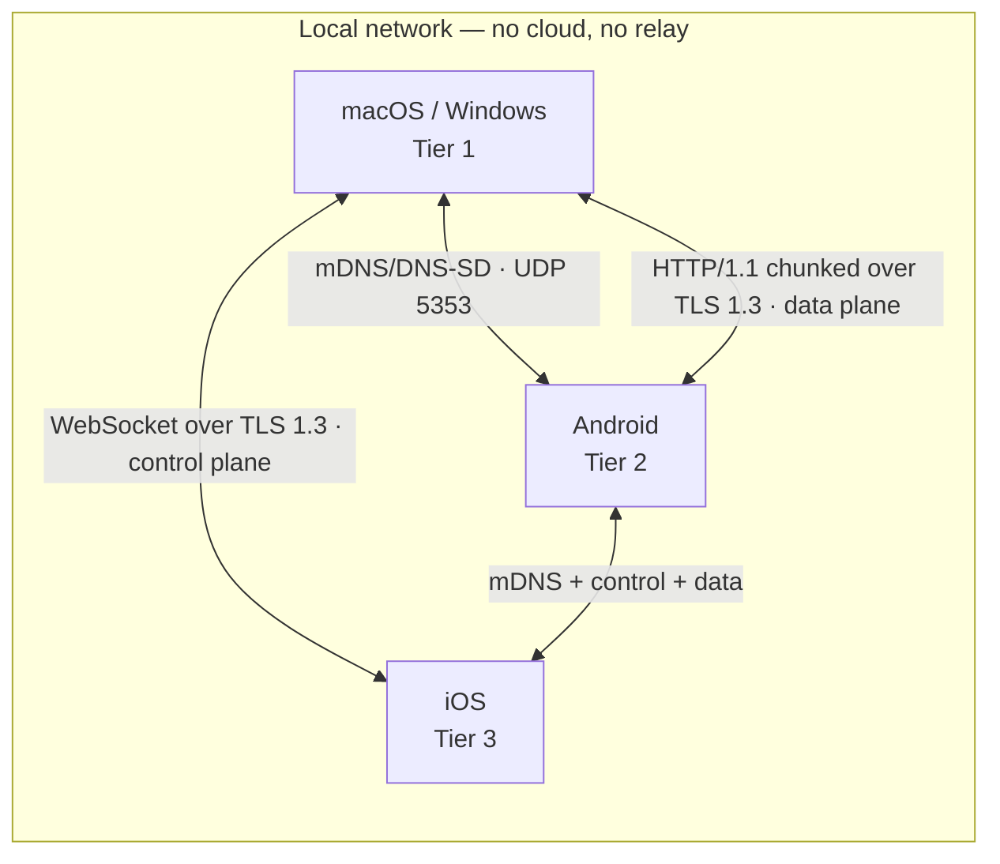

# DropClip

**A desktop-first, peer-to-peer clipboard continuity and high-throughput file transfer system for heterogeneous personal device clusters.**

**ดรอปคลิป — ระบบเชื่อมต่อคลิปบอร์ดและถ่ายโอนไฟล์ความเร็วสูงแบบ Peer-to-Peer บนเครือข่ายท้องถิ่น สำหรับคลัสเตอร์อุปกรณ์ส่วนบุคคลแบบข้ามแพลตฟอร์ม**

> **No cloud. No account. No relay. Just your LAN.**
> **ไม่ใช้คลาวด์ ไม่ต้องสมัครบัญชี ไม่มีรีเลย์ ทำงานบนเครือข่ายท้องถิ่นของคุณเท่านั้น**

[](https://github.com/nCotista/DropClip/releases/latest)
[](https://github.com/nCotista/DropClip/actions/workflows/ci.yml)
[](#en-platforms)
[](#en-security)
[](#en-security)
[](#en-testing)

**English** · [**ภาษาไทย**](#thai) · [**Protocol reference**](#protocol-reference) · [**Download**](#download)

---

<a id="download"></a>
## Download / ดาวน์โหลด

| Platform | Latest artifact | Install notes |
|---|---|---|
| **Windows 10/11** | [DropClip-Setup.exe](https://github.com/nCotista/DropClip/releases/latest/download/DropClip-Setup.exe) | Per-user install, no administrator rights. If SmartScreen warns: **More info → Run anyway**.<br>ติดตั้งระดับผู้ใช้ ไม่ต้องใช้สิทธิ์ผู้ดูแลระบบ |
| **macOS 12+** | [DropClip-macOS.zip](https://github.com/nCotista/DropClip/releases/latest/download/DropClip-macOS.zip) | Unsigned build: right-click the app → **Open** the first time. Apple Silicon and Intel.<br>บิลด์ยังไม่ลงนาม: คลิกขวาที่แอป → **Open** ครั้งแรก |
| **Android 10+** | [DropClip-Android.apk](https://github.com/nCotista/DropClip/releases/latest/download/DropClip-Android.apk) | Sideload the APK (debug-key signed); allow installs from unknown sources.<br>ติดตั้งแบบไซด์โหลด (ลงนามด้วย debug key) |
| **iOS 15+** | [DropClip-iOS-unsigned.ipa](https://github.com/nCotista/DropClip/releases/latest/download/DropClip-iOS-unsigned.ipa) | Unsigned IPA; re-sign with Sideloadly or AltStore before installing.<br>ไฟล์ IPA ยังไม่ลงนาม ต้องลงนามใหม่ก่อนติดตั้ง |

All releases / ทุกรุ่น: <https://github.com/nCotista/DropClip/releases>

---

<a id="english"></a>
# English

<a id="en-contents"></a>
## Contents

[Overview](#en-overview) · [Why DropClip](#en-why) · [Platforms & capability tiers](#en-platforms) · [Features](#en-features) · [Architecture](#en-architecture) · [Security model](#en-security) · [Repository layout](#en-layout) · [Getting started](#en-getting-started) · [Testing & quality gates](#en-testing) · [Project status & release](#en-status) · [Documentation](#en-docs) · [Team](#en-team) · [Contributing](#en-contributing) · [Security policy](#en-security-policy) · [License](#en-license)

<a id="en-overview"></a>
## Overview

DropClip is a **desktop-first, peer-to-peer clipboard continuity and high-throughput file transfer system** for heterogeneous personal device clusters. It connects macOS, Windows, Android, and iOS devices directly over the local network — **no cloud relay, no TURN/STUN, no account, no telemetry, and no internet connection required**.

Copy text, a link, or an image on one device and paste it on another. Drag a multi-gigabyte file and let DropClip stream it at LAN speed with SHA-256 integrity verification and resumable checkpoints.

DropClip is built on **platform-constrained honesty**: it does not pretend that every operating system allows the same background behavior. It delivers native-grade passive synchronization where the OS permits it (Tier 1), assisted synchronization on Android (Tier 2), and explicit user-driven flows on iOS (Tier 3), while keeping file transfer identical and full-featured on all four platforms.

### At a glance

| Item | Details |
|---|---|
| Full project name | *DropClip: A Desktop-First Peer-to-Peer Clipboard Continuity and High-Throughput File Transfer System for Heterogeneous Personal Device Clusters* |
| Current release | **v1.0.9** (15 November 2026) |
| Wire protocol | **v1** (specification PROTO-DC-V2.0) |
| Platforms | macOS 12+, Windows 10 (build 19041)+, Android 10 (API 29)+, iOS 15+ |
| Stack | Flutter 3.47.9 / Dart, Swift, C++, Kotlin |
| Transport | mDNS/DNS-SD, TLS 1.3, WebSocket, HTTP/1.1 chunked |
| Cloud dependency | **None — 100% local LAN peer-to-peer** |
| Project status | **34/34 tickets**, S0.1 + S0.2 spikes, **GATE-1…4 passed** |
| License | No `LICENSE` file yet; all rights reserved by the authors |

<a id="en-why"></a>
## Why DropClip

### The problem

1. **Ecosystem fragmentation.** Apple Universal Clipboard and AirDrop work only inside the Apple ecosystem. Users with an iPhone + Windows PC or Android + Mac have no equivalent first-party option.
2. **Workaround friction.** “Send it to myself in a chat app” or “upload it to cloud storage” hides real costs:

| Hidden cost | What it looks like |
|---|---|
| Repeated steps | Copy → open app → paste → send → switch device → download = 5–6 steps |
| Internet bottleneck | Data leaves the LAN and is limited by upload speed even when the devices are side by side |
| Quality loss | Chat and cloud apps re-encode images and video |
| Data risk | OTPs, passwords, and private documents pass through third-party servers |

3. **The existing-tool gap.** LocalSend is good for any-to-any file transfer but requires both apps open and a confirmation every time; it has no clipboard watcher. KDE Connect is Linux-first, and its clipboard sync requires interacting with a notification.

**DropClip closes the gap**: native-grade passive clipboard continuity on the macOS ↔ Windows axis, a cross-OS image format normalizer, and sensitive-content filtering, with mobile support that respects each OS’s sandbox rules.

### How it compares

| Capability | Apple Universal Clipboard | LocalSend | KDE Connect | ClipCascade | **DropClip** |
|---|:---:|:---:|:---:|:---:|:---:|
| macOS + Windows coverage | ✗ | ✓ | ~ | ✓ | **✓ Native** |
| Passive desktop clipboard sync | ✓ (Apple only) | ✗ | ~ | ✓ | **✓** |
| Cross-OS image clipboard | ✓ (Apple only) | ✗ | ✗ | ✗ | **✓ Normalizer** |
| Unlimited P2P file transfer | ✗ | ✓ | ✓ | ✗ | **✓** |
| Auto-accept for own devices | ✓ | ✗ | ~ | — | **✓ (opt-in)** |
| No account / no cloud | ✗ | ✓ | ✓ | ~ | **✓** |
| Automatic sensitive-content filtering | ✗ | — | ✗ | ✗ | **✓** |
| iOS support | ✓ | ✓ | ~ | ✗ | **~ Assisted (Tier 3)** |

`✓` supported · `~` partial · `✗` not supported · `—` not applicable

<a id="en-platforms"></a>
## Platforms & capability tiers

Clipboard synchronization is classified into three capability tiers because each OS applies different background-execution rules. **The tiers apply only to clipboard synchronization**; file transfer is full-featured on all four platforms.

| Tier | Platforms | Clipboard synchronization | File transfer |
|---|---|---|---|
| **Tier 1 — Full Passive** | macOS 12+, Windows 10/11 | Bidirectional, zero-interaction background sync; text **p50 < 300 ms**, **p95 < 1,000 ms** | Full |
| **Tier 2 — Assisted** | Android 10+ (API 29+) | **Desktop → Android:** automatic write through a Foreground Service. **Android → Desktop:** one-click send from a Quick Settings Tile or notification action; **p95 < 1,200 ms** inbound, **< 800 ms** outbound | Full |
| **Tier 3 — Manual-Assist** | iOS 15+ | Share Sheet Extension, Home/Lock Screen widgets, Action Button, Shortcuts; **< 1,500 ms** | Full |

> **Why the tiers exist:** Android 10+ forbids background apps from reading the clipboard, and iOS suspends background apps and shows a paste-permission prompt. These are OS privacy rules that apply to every app equally, not architectural limitations of DropClip.

### System requirements

| Platform | Minimum version | Architectures | RAM | Free disk |
|---|---|---|---|---|
| **macOS** | 12.0 Monterey (through macOS 15 Sequoia) | Apple Silicon + Intel x86_64 | 4 GB | 150 MB |
| **Windows** | 10 build 19041 or Windows 11 | x64 + ARM64 | 4 GB | 150 MB |
| **Android** | 10 (API 29) through Android 15 | ARM64-v8a | 3 GB | 80 MB |
| **iOS** | 15.0 through iOS 18 | iPhone / iPad ARM64 | — | 80 MB |

**Network:** both devices must be on the same subnet; the router must allow multicast (UDP 5353) and TCP 53317–53417; AP/Client Isolation must be disabled. DropClip works fully offline and never needs internet access.

<a id="en-features"></a>
## Features

### Clipboard continuity

- **Tier 1 passive sync** between macOS and Windows, both directions, with no button presses.
- **Tier 2 inbound sync** on Android through a `connectedDevice` Foreground Service; **one-click outbound** through a Quick Settings Tile or notification action.
- **Tier 3 explicit flows** on iOS through the Share Sheet, widgets, Action Button, and Shortcuts.
- Plain text, URLs, PNG, and JPEG up to **32 MiB**.
- **Cross-OS image normalizer** for macOS TIFF, Windows `CF_DIB` / `CF_DIBV5`, and PNG, preserving alpha transparency and DPI; 4K conversion target **< 200 ms** and SSIM **≥ 0.99**.
- **Hybrid Logical Clock (HLC) + Last-Writer-Wins** conflict resolution, with `origin_device_id`, an **800 ms** echo-suppression window, a **200-entry** LRU dedup cache, and a **60 s** maximum clock-drift bound.
- Clipboard **TTL** from 5 to 3,600 seconds; expired content is cleared only if it is still the current clipboard item.
- **100% suppression** of all five recognized OS sensitive-content markers.
- Catch-up queue of the **20** latest items; outbound queue of **50** messages per peer while offline.

### File transfer

- **Unlimited file size** over the LAN, streamed in **1 MiB** chunks — never buffered whole in RAM.
- **SHA-256** per chunk and for the complete file; the receiver verifies before the `.part` file is renamed.
- **64 MiB resumable checkpoints** in a `.part.json` sidecar; resume from the last verified byte offset after a Wi-Fi drop, with **24-hour** stale-part retention.
- Validated with **4 GB** transfers on mobile and **10 GB** on desktop; throughput target **≥ 60% of the iperf3 TCP baseline**.
- **Delta RSS ≤ 50 MB** over baseline during large transfers; constant memory on desktop.
- **Zero-click auto-accept** is available per trusted device but **disabled by default**.
- Pre-flight disk-space check (`507 E_DISK_FULL`), safe duplicate naming (`name (1).ext`), and no silent overwrite.
- Path sanitization against traversal, absolute paths, drive letters, UNC paths, null bytes, bidi overrides, and Windows reserved names; no symlink or hardlink creation.
- Received files are **never opened or executed automatically**; macOS gets `com.apple.quarantine`, Windows gets Mark-of-the-Web.
- Up to **3 concurrent transfers per peer** and **10,000 items per transfer**; progress reported at least every **500 ms**.

### Discovery and connectivity

- Zero-configuration discovery through **mDNS/DNS-SD** (`_dropclip._tcp`, UDP 5353) with a **< 3 s** discovery target.
- TXT record carries protocol version, device ID, Base64 device name, OS, tier, port, and certificate fingerprint — never secrets.
- Peer marked **stale after 30 s** and removed after **120 s**; IP changes update the existing entry.
- Fallback discovery by **QR code** (IP + fingerprint) or **manual IP** when multicast is blocked.
- Persistent **WebSocket over TLS 1.3** control plane; heartbeat every **15 s**, timeout at **45 s**, exponential reconnect backoff from **1 s to 30 s** with ±20% jitter.
- Protocol version negotiation: `min(local.v, remote.v) ≥ max(local.min_v, remote.min_v)`; otherwise close with **4003 `E_UNSUPPORTED_VERSION`**.
- Supports up to **8 peers** and ignores unknown JSON fields for forward compatibility.

### Security and privacy

- **TLS 1.3 only** with modern AEAD cipher suites; TLS 1.2 and downgrade attempts are rejected.
- Per-device **ECDSA P-256 (`secp256r1`)** self-signed certificates, pinned by **SPKI SHA-256** fingerprint.
- Private keys are **envelope-encrypted** with OS secure storage (Apple Keychain, Windows DPAPI/CNG, Android Keystore); no plaintext key ever touches disk.
- **Commit-then-Reveal SAS pairing** and **Zero-PIN-on-Wire**; the PIN is only a local out-of-band salt, never transmitted.
- Pairing limits: nonce TTL **60 s**, confirmation window **120 s**, **5 requests/minute/IP**, lockout after **3 failures for 5 minutes**.
- **Signed cluster revocation** with **Quarantine-then-Confirm**, **no self-revocation by proxy**, persistent tombstones, and handshake anti-entropy.
- Explicit quotas: **64 KiB** WebSocket frame, **32 KiB** inline clipboard, **32 MiB** maximum clipboard content, **64,000,000** image pixels.
- **No telemetry, no analytics SDKs, no cloud accounts.** Logs are scrubbed of keys, certificates, PINs, nonces, and clipboard content.
- User-initiated **Diagnostic Bundle** export (scrubbed `.zip`), plus CycloneDX 1.5 SBOM generation in CI.

### Desktop and mobile experience

- Desktop system tray / menu bar, floating **Dropzone** (`⌥⌘D` on macOS, `Ctrl+Alt+D` on Windows), Transfers, Devices, and Settings pages.
- Quiet startup to the tray, optional auto-start (SMAppService / LaunchAgent on macOS, registry on Windows).
- Live **English ↔ Thai** language switching without restarting the app.
- Full keyboard navigation and WCAG 2.1 AA contrast (**≥ 4.5:1**); dark and light themes.
- Debug console (`⌘⇧D` / `Ctrl+Shift+D`) showing scrubbed structured JSON logs.
- Android Quick Settings Tile, notification action, and share target; iOS Share Extension, widgets, Action Button, and Shortcuts.
- Transfer progress with percentage, speed, and ETA; device list with online/offline and trust status.

<a id="en-architecture"></a>
## Architecture



### Control plane and data plane

| Plane | Transport | Purpose | Limits |
|---|---|---|---|
| **Discovery** | mDNS/DNS-SD over UDP 5353 | Advertise and find peers; TXT metadata | Public data only; no secrets |
| **Control** | WebSocket over TLS 1.3 | `hello`, clipboard text, file offers, progress, revocation, heartbeat | **64 KiB** maximum frame; inline clipboard **32 KiB** |
| **Data** | HTTP/1.1 chunked over TLS 1.3 | Images, blobs, and streamed files | Clipboard blob **32 MiB**; files unlimited |
| **Persistence** | Local files only | Identity, trusted devices, HLC state, checkpoints, config | `schema_version` migrations; no cloud |

### Core components

| Path | Responsibility |
|---|---|
| `packages/dropclip_protocol` | Wire envelopes, 16 message types, 18 error codes, HLC, SAS calculation, path sanitizer, payload schemas |
| `packages/dropclip_core` | mDNS discovery, TLS 1.3 server and pinned client, WebSocket control plane and reconnect engine, pairing, device identity and trusted store, revocation, logging, test harness |
| `packages/dropclip_clipboard` | Clipboard sync engine, transport adapter, PNG/TIFF/DIB image normalizer |
| `packages/dropclip_transfer` | 1 MiB streaming sender and receiver, 64 MiB checkpoint store, SHA-256 verification |
| `packages/dropclip_ui` | Design tokens, themes, and shared Flutter widgets |
| `packages/dropclip_macos` | Swift `NSPasteboard` plugin bridge |
| `packages/dropclip_windows` | C++ Win32 clipboard plugin bridge |
| `apps/desktop` | Flutter desktop app for macOS and Windows |
| `apps/mobile` | Flutter mobile app for Android and iOS |
| `native/macos`, `native/windows`, `native/android`, `native/ios` | Native platform services and extensions |
| `tools/protocol_fuzzer`, `tools/bench` | Protocol fuzzing and performance benchmarks |

### Architecture decision records

| ADR | Decision | Rationale |
|---|---|---|
| **ADR-001** | Flutter/Dart + native platform channels | ~75% shared code; native code limited to clipboard and OS integration; proven by LocalSend |
| **ADR-002** | TLS 1.3 + self-signed certificate + SPKI pinning | No homegrown cryptography; forward secrecy; revocation by removing a pin |
| **ADR-003** | Separate control and data planes | Large images on WebSocket would block clipboard text; WS framing is not for bulk transfer |
| **ADR-004** | HTTP/1.1 chunked, not HTTP/2 | HTTP/2 flow-control windows hurt LAN throughput; one connection carries one file |
| **ADR-005** | Melos monorepo | One command runs format, analyze, and tests across every package |
| **ADR-006** | ECDSA P-256 instead of Ed25519 | Hardware/OS support across Apple, Windows, and Android targets; required for mTLS paths |
| **ADR-007** | Android `connectedDevice` + iOS background `URLSession` | Avoids Android 15 `dataSync` limits; keeps the iOS Share Extension below Jetsam limits |
| **ADR-008** | Hybrid Logical Clock instead of a pure Lamport clock | Prevents new offline copies from losing LWW to old remote clocks; 60 s drift cap |
| **ADR-009** | Commit-then-Reveal SAS | Prevents active MITM brute-force; PIN is never sent over the wire |

<a id="en-security"></a>
## Security model

### Encrypted channel and identity

- Every control and data connection runs over **TLS 1.3** with modern AEAD cipher suites; TLS 1.2 and downgrade attempts are rejected.
- Each device generates a self-signed **ECDSA P-256** certificate on first run. The peer pins the **SPKI SHA-256** fingerprint, not a CA chain.
- The private key is envelope-encrypted with the OS secure store: Apple Keychain, Windows DPAPI/CNG, and the Android Keystore wrapping key. The key is never written as plaintext.
- Every request re-checks the peer fingerprint; an unknown or revoked peer receives **`403 E_NOT_PAIRED`**.

### Pairing: Commit-then-Reveal and Zero-PIN-on-Wire

The host generates a 16-byte `nonce_A` with a **60-second TTL** and shows it out-of-band (QR code), or shows a 6-digit PIN in manual mode. The client generates `nonce_B` and sends a commitment **before** the host reveals `nonce_A`:

$$
C_B = \operatorname{SHA256}(\text{"dropclip-commit-v1:"} \parallel N_B \parallel \mathrm{fp}_B)
$$

After the host reveals `nonce_A`, the client reveals `nonce_B`. Both sides compute the same 6-digit SAS locally:

$$
\mathrm{SAS}_{QR} = \operatorname{SHA256}(\mathrm{fp}_{lo} \parallel \mathrm{fp}_{hi} \parallel N_A \parallel N_B) \bmod 10^6 = 337017
$$

$$
\mathrm{SAS}_{PIN} = \operatorname{SHA256}(\mathrm{fp}_{lo} \parallel \mathrm{fp}_{hi} \parallel N_A \parallel N_B \parallel \text{"dropclip-pin-salt-v1:"} \parallel \mathrm{UTF8}(PIN)) \bmod 10^6 = 639589
$$

**The PIN or any PIN-derived value is never transmitted.** It is only an out-of-band salt for the local SAS calculation, which removes the offline dictionary oracle. The user must visually compare the SAS on both screens and confirm on both devices.

### Sensitive-content suppression (100%)

Clipboard content with any of these OS markers is dropped before its payload is read or sent:

1. macOS `org.nspasteboard.ConcealedType`
2. macOS `org.nspasteboard.TransientType` / `com.agilebits.onepassword`
3. Windows `ExcludeClipboardContentFromMonitorProcessing`
4. Windows `CanIncludeInClipboardHistory` or `CanUploadToCloudClipboard` set to `0` / `FALSE`
5. Android `ClipDescription.EXTRA_IS_SENSITIVE` / `Clipboard.EXTRA_IS_SENSITIVE`

Logs record only the event type and size, never the content. Password-manager items never leave the source device.

### Revocation safety

- The revoking device removes the target fingerprint locally and disconnects within **< 1 s**.
- It signs a `RevocationBroadcastToken` with ECDSA P-256, stores a persistent tombstone, and broadcasts `cluster.revocation` to online peers; online peers quarantine the target within **< 2 s**.
- **No self-revocation by proxy:** a node ignores any broadcast where `revoked_id == my_id`.
- **Quarantine-then-Confirm:** a valid revocation of another peer only quarantines it until the local user confirms. If the user rejects it, the revoker is quarantined instead.
- Offline peers exchange `tombstones_hash` in `hello` / `hello.ack` and repair gaps through `revocation.sync`, so a revoked device cannot rejoin through a node that was offline.

### Threat model summary

| Threat | CVSS v3.1 | Mitigation |
|---|:---:|---|
| **T-T02** Path traversal / arbitrary file overwrite | **9.6 Critical** | Strict 12-vector path sanitizer, destination sandbox, no symlinks/hardlinks |
| **T-R01** Forged cluster revocation | **8.1 High** | ECDSA P-256 signed revocation token; only trusted signers accepted |
| **T-S04** Stale revocation replay after offline period | **8.1 High** | Persistent tombstones + handshake anti-entropy |
| **T-E01** Arbitrary code execution on file receipt | **8.0 High** | Never auto-open or auto-execute; macOS quarantine; Windows Mark-of-the-Web |
| **T-E03** Rogue paired peer abuses auto-accept | **7.4 High** | Auto-accept off by default; per-device opt-in; quarantine |
| **T-S03** Stolen peer issues malicious revocations | **7.3 High** | No self-revocation by proxy; Quarantine-then-Confirm |
| **T-D03** Future clock drift hijacks LWW | **7.1 High** | Hard 60 s maximum clock drift; reject offending messages |
| **T-S02** Active MITM during pairing | **6.4 Medium** | Commit-then-Reveal + Zero-PIN-on-Wire + user SAS check |
| **T-I01** Password-manager clipboard leak | **6.2 Medium** | 100% suppression of all five OS markers |

The full STRIDE analysis, attack trees, CVSS vectors, and residual risks are in [`docs/04-THREAT-MODEL.md`](docs/04-THREAT-MODEL.md).

### Privacy and compliance

- **Zero-cloud:** no user database, no PII stored off-device, no telemetry, and no analytics SDKs.
- Local Network and Bonjour usage is declared for the App Store; Google Play receives the `connectedDevice` Foreground Service rationale.
- Scoped Storage / `MediaStore` and `PhotoKit` are used without requesting `MANAGE_EXTERNAL_STORAGE`.
- Received files are never executed; macOS quarantine and Windows Mark-of-the-Web are applied.
- A scrubbed diagnostic bundle can be exported manually for incident triage.

<a id="en-layout"></a>
## Repository layout

```text
DropClip/
├── apps/
│   ├── desktop/                  # Flutter Desktop (macOS & Windows)
│   └── mobile/                   # Flutter Mobile (Android & iOS)
├── packages/
│   ├── dropclip_protocol/        # Wire protocol, envelopes, HLC, SAS, path sanitizer
│   ├── dropclip_core/            # Discovery, TLS, control plane, pairing, identity, revocation
│   ├── dropclip_clipboard/       # Clipboard sync engine and image normalizer
│   ├── dropclip_transfer/        # 1 MiB streaming engine and 64 MiB checkpoints
│   ├── dropclip_ui/              # Design tokens, themes, shared widgets
│   ├── dropclip_macos/           # Swift NSPasteboard plugin
│   └── dropclip_windows/         # C++ Win32 clipboard plugin
├── native/
│   ├── macos/                    # Swift clipboard watcher and concealed-type detection
│   ├── windows/                  # C++ Win32 clipboard core, codec, and tests
│   ├── android/                  # Kotlin Foreground Service, QS Tile, MediaStore
│   └── ios/                      # Swift Share Extension, widgets, PhotoKit
├── tools/
│   ├── protocol_fuzzer/          # 10,000-frame fuzzing and 100,000-frame pentest mode
│   └── bench/                    # SAS and performance benchmark suite
├── docs/
│   ├── 00-PROJECT-PROPOSAL-AND-PLAYBOOK.md
│   ├── 01-PROTOCOL-SPEC.md
│   ├── 02-TICKETS.md
│   ├── 03-SRS.md
│   ├── 04-THREAT-MODEL.md
│   ├── 05-RELEASE-AND-UPDATE-PLAN.md
│   ├── 06-USER-AND-TESTING-MANUAL.md
│   ├── 07-BUG-REPORT-AND-TEST-CASES.md
│   ├── TASK-PROGRESS-AND-UPDATES.md
│   └── worklogs/                 # Per-ticket implementation and test evidence
├── .github/workflows/            # CI, native builds, benchmarks, installers, releases
├── melos.yaml                    # Monorepo scripts
├── AGENTS.md                     # AI/developer operating rules
├── CONTRIBUTING.md               # Branching, commits, PR workflow
└── README.md
```

<a id="en-getting-started"></a>
## Getting started

### Prerequisites

| Tool | Requirement |
|---|---|
| **Flutter** | **3.47.9 stable** (Dart is bundled) |
| **Melos** | `^6.0.0` — `dart pub global activate melos ^6.0.0` |
| **Windows build** | Visual Studio 2022 with **Desktop development with C++** and the Windows 10/11 SDK |
| **macOS build** | Xcode with the macOS SDK; CocoaPods for plugin dependencies |
| **Android build** | JDK 17, Android SDK, and NDK; API 29+ device or emulator |
| **iOS build** | Xcode; an Apple signing identity for physical devices; App Group for the Share Extension |
| **Network** | Same Wi-Fi/LAN, multicast enabled, AP/Client Isolation disabled |

### Bootstrap and run from source

```bash
git clone https://github.com/nCotista/DropClip.git
cd DropClip
dart pub global activate melos ^6.0.0
melos bootstrap
```

```bash
# Desktop (terminal 1)
cd apps/desktop
flutter run -d macos      # or: flutter run -d windows

# Mobile (terminal 2)
cd apps/mobile
flutter run               # or: flutter run -d macos/windows for a second desktop window
```

### Build release artifacts

```bash
cd apps/desktop && flutter build macos --release
cd apps/desktop && flutter build windows --release
cd apps/mobile  && flutter build apk --release
cd apps/mobile  && flutter build ios --release --no-codesign
```

The Windows installer is assembled by `.github/workflows/windows-installer.yml` using `apps/desktop/installer/build_installer.ps1` and published as `DropClip-Setup-<version>.exe`.

### Quick acceptance test (non-coder friendly)

Full step-by-step instructions are in [`docs/06-USER-AND-TESTING-MANUAL.md`](docs/06-USER-AND-TESTING-MANUAL.md).

| # | Test | What to do | Expected result |
|---|---|---|---|
| 1 | **Pairing + SAS** | Desktop → **Devices**, PIN `123456`; Mobile → **Devices** → **Pair & Compute SAS**; confirm on both | Both show **SAS `639589`**; green *“Peer pinned in Trusted Peer Store”* |
| 2 | **Clipboard** | Desktop: copy text → **Send clipboard**; filter/search. Mobile: **Send to Cluster** / **Simulate Inbound Clip** | Item appears instantly in history; filters work; sync latency < 1,000 ms |
| 3 | **Sensitive suppression** | Mobile: enable **Mark as Sensitive**, paste a password, press **Send to Cluster** | Red banner **“Suppressed sensitive clipboard item (NFR-S04)”**; nothing is sent |
| 4 | **Dropzone file transfer** | Desktop: `⌥⌘D` / `Ctrl+Alt+D`, drag a file, choose a device, send | **Transfers** shows **100% · SHA-256 Verified** |
| 5 | **Resume `.part`** | **Transfers** → resume the 50% `4K-Demo-Recording.mp4.part` | Progress continues from 50% to 100% and verifies |
| 6 | **Revocation** | **Devices** → **Quarantine** → **Confirm Revoke** or **Restore Peer** | Status moves `TRUSTED → QUARANTINED → REVOKED` or back to `TRUSTED` |
| 7 | **Language + logs** | **Settings**: switch **English / ไทย**; press `⌘⇧D` / `Ctrl+Shift+D` | UI changes instantly; debug console shows scrubbed JSON logs with no secrets |

### Troubleshooting

| Problem | Fix |
|---|---|
| `melos: command not found` | Run `dart pub global activate melos ^6.0.0`, then reopen the terminal |
| Devices do not see each other | Confirm the same Wi-Fi/LAN, private network profile, multicast enabled, and AP/Client Isolation off; use manual IP pairing as a fallback |
| Windows Firewall prompt | Allow access on **Private networks** |
| macOS blocks the unsigned app | Right-click the app → **Open**; or build from source |
| Windows SmartScreen warning | **More info → Run anyway** (build is not Authenticode-signed yet) |
| Android blocks the APK | Allow installs from unknown sources; the APK is debug-key signed |
| iOS cannot install the IPA | Re-sign it with Sideloadly/AltStore using your Apple ID; accept **Local Network** on first launch |
| No background clipboard reads on Android | Expected: Android 10+ blocks background reads; use the Quick Settings Tile or notification action |
| iOS shows a paste-permission prompt | Expected: iOS 16+ requires confirmation; choose **Allow Paste** |

<a id="en-testing"></a>
## Testing & quality gates

### Test strategy

| Level | Share | Focus | When |
|---|:---:|---|---|
| **Unit** | 60% | Pure Dart logic, protocol, HLC, SAS, sanitizer, sync engine | Every commit |
| **Integration** | 25% | TLS, WebSocket, pairing, file streaming, platform channels | Every PR |
| **End-to-end** | 10% | Real devices on a real Wi-Fi network | Nightly |
| **Manual / exploratory** | 5% | Usability, OS prompts, edge scenarios | Before each milestone |

### Commands

```bash
melos run format          # check formatting
melos run analyze         # dart analyze --fatal-infos
melos run test            # pure Dart + Flutter tests
melos run test:coverage   # coverage output, gate ≥ 75%
melos run build:runner    # code generation
```

**Native C++ clipboard core:**

```bash
cd native/windows/test
g++ -std=c++17 -Wall -Wextra -Werror -I.. -o clipboard_core_test clipboard_core_test.cpp
./clipboard_core_test
```

**Protocol fuzzer:**

```bash
cd tools/protocol_fuzzer
dart run bin/fuzzer.dart            # 10,000 frames
dart run bin/fuzzer.dart --pentest  # 100,000 frames
```

**Benchmark suite:**

```bash
cd tools/bench
dart run bin/bench.dart
```

### CI and automation

| Workflow | What it verifies |
|---|---|
| `ci.yml` | Format, `analyze --fatal-infos`, and tests on Ubuntu, macOS, and Windows; native C++ `g++ -Werror`; Windows desktop build with MSVC `/W4 /WX`; plaintext-secret scan |
| `macos-native.yml` | Swift XCTest for the native macOS clipboard watcher |
| `mobile-build.yml` | Android APK build and unsigned iOS build |
| `benchmark.yml` | Performance-regression thresholds (NFR-P01…P05, NFR-R01) |
| `windows-installer.yml` | Builds and smoke-tests `DropClip-Setup-<version>.exe` |
| `release-apps.yml` | macOS zip, Android APK, and unsigned iOS IPA attached to a `v*` release |

### Non-negotiable engineering rules

1. **PR size ≤ 400 lines** of diff, excluding generated files.
2. **No code without tests** — happy path plus at least three edge cases.
3. **Spikes are timeboxed to 4 hours**; escalate when blocked.
4. **No homegrown cryptography** — use TLS 1.3 and OS secure storage.
5. **No whole-file RAM buffering** — stream in 1 MiB chunks; `readAsBytes()` is rejected for transfers.
6. **Conventional Commits** — `<type>(<scope>): <summary> (<TICKET_ID>)`.

Additional gates: `melos run format` clean, `melos run analyze` with **0 issues**, **≥ 75%** package coverage, no plaintext secrets or clipboard contents in logs, and LEAD review for security-sensitive changes.

### Verification evidence

- **42 manual test cases** across installation, pairing, clipboard, files, connection, settings, and security (`docs/07-BUG-REPORT-AND-TEST-CASES.md`).
- **10,000-frame** protocol fuzz run and a **100,000-frame** pentest mode.
- **4-node, 1,000-event** convergence test with no infinite loop or lost valid data.
- **20 rapid reconnect** cycles with zero socket leaks.
- **SHA-256 100%** file-integrity target over 500 transfers.
- **72-hour soak** with RSS growth **≤ 5%** after warm-up.
- **13-vector** path-traversal conformance suite; **15/15** path attacks blocked in the security audit suite.
- **4 GiB** streaming evidence recorded in the S0.2 worklog.

### Device test matrix

| Platform | Coverage |
|---|---|
| macOS | Apple Silicon + Intel; macOS 12 through the latest release |
| Windows | Windows 10 + 11; x64 + ARM64 |
| Android | Pixel, Samsung, Xiaomi; Android 10/13/14/15 |
| iOS | iPhone + iPad; iOS 15 through the latest release |
| Network | Three router brands, Wi-Fi 5/6, with and without VLAN |

<a id="en-status"></a>
## Project status & release

| Item | Status |
|---|---|
| **Current release** | **v1.0.9** — 15 November 2026 |
| **Tickets** | **34 / 34 done (100%)** |
| **Spikes** | S0.1 cross-platform mTLS P-256 — done; S0.2 mobile background constraints — done with a documented exception |
| **Gates** | **GATE-1, GATE-2, GATE-3, GATE-4 passed** |
| **CI on `main`** | Passing: format, analyze, tests, fuzzer, secret scan |
| **Documentation** | Aligned to SRS-DC-V1.2 and PROTO-DC-V2.0 |
| **Artifacts** | Windows installer, macOS zip, Android APK, unsigned iOS IPA |

### Delivery phases

| Phase | Scope | Duration | Status |
|---|---|---|---|
| **Phase 0** | Foundation, monorepo, CI, protocol package, threat model, signing plan | Weeks 1–2 | Done |
| **Phase 1** | Desktop core: discovery, pairing, TLS, clipboard sync, streaming files, desktop UI, revocation | Weeks 3–12 | Done |
| **Phase 2** | Android: Foreground Service, Quick Settings Tile, clipboard receiver, MediaStore, mobile UI | Weeks 13–17 | Done |
| **Phase 3** | iOS: Local Network permission, Share Extension, widgets/Action Button/Shortcuts, PhotoKit receiver | Weeks 18–21 | Done |
| **Phase 4** | Hardening: benchmarks, pentest, chaos/soak, SUS study, packaging, release | Weeks 22–24 | Done |

### Targets from the SRS and playbook

| Metric | Target |
|---|---|
| Text clipboard latency, Tier 1 | p50 < 300 ms; p95 < 1,000 ms |
| Image clipboard latency (2 MB) | p95 < 2,500 ms |
| Desktop → Android inbound | p95 < 1,200 ms |
| Android → Desktop outbound | < 800 ms |
| iOS → Desktop | < 1,500 ms |
| Discovery time | < 3 s |
| File throughput | ≥ 60% of the iperf3 TCP baseline |
| Delta RSS during large transfers | ≤ 50 MB |
| iOS Share Extension peak RAM | < 30 MB |
| Idle CPU | < 0.5% desktop; < 0.2% Windows |
| Android battery drain | < 3% per 24 h |
| File integrity | 100% SHA-256 match over 500 transfers |
| Convergence | 4 nodes, 1,000 events, no loop or data loss |
| Test coverage | ≥ 75% per package |
| SUS score | ≥ 75 |
| Interaction reduction | ≥ 70% |
| Task-time reduction | ≥ 60% |
| Revocation | < 1 s locally; < 2 s cluster-wide |
| 4K image conversion | < 200 ms |

### Release and update strategy

DropClip follows **Semantic Versioning 2.0.0**. Because app stores and auto-updaters do not support downgrades, defects are handled **roll-forward**: a new higher patch or minor version is published, never a downgrade. Persistent stores carry `schema_version` and safe migrations; trusted devices and OS-stored keys are never deleted during an update.

Planned distribution channels are macOS Developer ID + notarization + Sparkle, Windows Authenticode + WinSparkle/winget, Google Play staged rollout, and TestFlight/App Store phased release. Current GitHub artifacts are **not store-signed** and are intended for testing and direct sideloading.

### Known limitations and validation caveats

- **Unsigned artifacts:** macOS app is unsigned, the Windows installer is not Authenticode-signed, the Android APK uses the debug key, and the iOS IPA is unsigned.
- **iOS physical background validation is open:** a Simulator Share Extension uploaded 4 GiB with a matching SHA-256, but its high-water RSS was **187.70 MiB**, so the **< 30 MB physical-device target and background-session persistence remain unverified**.
- **Android overnight service is not fully proven:** a SIGKILL was observed overnight and `START_STICKY` recovery worked, but uninterrupted overnight service and Doze behavior remain open; an Android 14 physical-device artifact was not supplied.
- **Network dependency:** mDNS discovery requires multicast and no AP/Client Isolation; manual IP/QR pairing is the fallback.
- **Out of scope:** public-internet relay, NAT traversal, TURN/STUN, Linux, passive background clipboard on iOS/Android, rich text (RTF/HTML), files or video inside the clipboard, and remote control.

### Roadmap

- Store-signed releases with Apple notarization and Windows Authenticode.
- Physical iOS background Share Extension validation and < 30 MB RSS proof.
- Android 14/15 physical-device and Doze endurance validation.
- Expanded accessibility and localization audits.
- Linux support evaluation.

<a id="en-docs"></a>
## Documentation

| Document | Purpose |
|---|---|
| [`docs/00-PROJECT-PROPOSAL-AND-PLAYBOOK.md`](docs/00-PROJECT-PROPOSAL-AND-PLAYBOOK.md) | Proposal, engineering playbook, ADRs, risk analysis, and delivery plan |
| [`docs/01-PROTOCOL-SPEC.md`](docs/01-PROTOCOL-SPEC.md) | Normative wire protocol: discovery, TLS, pairing, messages, endpoints, limits, conformance vectors |
| [`docs/02-TICKETS.md`](docs/02-TICKETS.md) | 34 task tickets, team allocation, DoR/DoD, RTM, and workflow |
| [`docs/03-SRS.md`](docs/03-SRS.md) | Software Requirements Specification (SRS-DC-V1.2): FR-01…FR-12, NFRs, interfaces |
| [`docs/04-THREAT-MODEL.md`](docs/04-THREAT-MODEL.md) | STRIDE analysis, attack trees, CVSS v3.1 scoring, and security verification plan |
| [`docs/05-RELEASE-AND-UPDATE-PLAN.md`](docs/05-RELEASE-AND-UPDATE-PLAN.md) | Versioning, packaging, signing, roll-forward, SBOM, and disclosure |
| [`docs/06-USER-AND-TESTING-MANUAL.md`](docs/06-USER-AND-TESTING-MANUAL.md) | Seven-step non-coder testing manual and FAQ |
| [`docs/07-BUG-REPORT-AND-TEST-CASES.md`](docs/07-BUG-REPORT-AND-TEST-CASES.md) | Bug reports BUG-01…BUG-03 and 42 manual test cases |
| [`docs/TASK-PROGRESS-AND-UPDATES.md`](docs/TASK-PROGRESS-AND-UPDATES.md) | Central ticket status board and branch completion registry |
| [`docs/worklogs/`](docs/worklogs/) | Per-ticket implementation notes and test evidence |
| [`CONTRIBUTING.md`](CONTRIBUTING.md) | Branching, commit format, PR workflow, and Definition of Done |
| [`AGENTS.md`](AGENTS.md) | Operating rules for AI assistants and developers |
| [`UPDATES.md`](UPDATES.md) | Shortcut to the central progress board |
| [`.well-known/security.txt`](.well-known/security.txt) | RFC 9116 vulnerability-disclosure contact |

<a id="en-team"></a>
## Team and acknowledgements

Role codes are used in tickets, branches, and commit scopes.

| Role | Member | Primary responsibilities |
|:---:|---|---|
| **LEAD** | นายธนกฤต บุญญาวรกุล (เจ) | Team lead, protocol architecture, security and pairing, macOS native integration, code signing, CI/CD |
| **DESK** | นายณัฐธีร์ อโณทัยไพบูลย์ (ธีร์) | mDNS discovery, Tier 1 clipboard sync engine, desktop UI, Dropzone, tray/menu bar |
| **MOB** | นายเกื้ออนันต์ พวงนิลน้อย (เกื้อ) | Mobile background spike, Android Foreground Service/QS Tile, iOS Share Extension/widgets |
| **NET** | นายปัณณ์ ศรีเจริญชัยกุล (ปัน) | TLS 1.3 transport, WebSocket control plane, Windows native, image normalizer, streaming file engine |
| **QA** | นายปรมินทร์ มุขอาษา (ตามด) | Structured logging, protocol fuzzer, benchmarks, chaos/soak verification, usability and SUS study |

**Contributors:** **OpenAI Codex** — AI-assisted development, testing, and debugging alongside Kueranan (MOB).

<a id="en-contributing"></a>
## Contributing

1. Pick a ticket from [`docs/02-TICKETS.md`](docs/02-TICKETS.md) and branch from `main`: `feat/<TICKET_ID>-<slug>`, `spike/<SPIKE_ID>-<slug>`, or `fix/<TICKET_ID>-<slug>`.
2. Implement code and tests; keep the PR diff **≤ 400 lines** excluding generated files.
3. Run `melos run format`, `melos run analyze`, and `melos run test`.
4. Commit with a Conventional Commit message: `feat(discovery): implement mdns advertiser (T1.1)`.
5. Open a PR with at least one approval; security-sensitive work requires **LEAD** approval.
6. Record worklogs and update the status board **only** on the `docs/task-progress-tracker` branch — never in a feature branch.

See [`CONTRIBUTING.md`](CONTRIBUTING.md) and [`AGENTS.md`](AGENTS.md) for the complete rules.

<a id="en-security-policy"></a>
## Security policy

Please **do not open a public issue** for a vulnerability. Report it privately through **GitHub Security Advisories**:

<https://github.com/nCotista/DropClip/security/advisories/new>

- **P0** (remote code execution, wire eavesdropping, authentication bypass): acknowledge and prioritize within **24 hours**.
- **P1** (core function broken): patch within **72 hours**.
- **Coordinated disclosure:** the team has **7 days** to develop and ship a roll-forward patch before public details are disclosed.
- **Safe harbor:** good-faith research that avoids real data theft, DoS, and public disclosure before the fix is protected.

<a id="en-license"></a>
## License

No `LICENSE` file is currently present in this repository. Until a license is added, the source is available for viewing and academic evaluation only; **all rights remain with the authors**. Add a recognized open-source license before redistributing or accepting external contributions.

---

<a id="thai"></a>
# ภาษาไทย

<a id="th-contents"></a>
## สารบัญ

[ภาพรวม](#th-overview) · [ทำไมต้อง DropClip](#th-why) · [แพลตฟอร์มและระดับขีดความสามารถ](#th-platforms) · [ฟีเจอร์](#th-features) · [สถาปัตยกรรม](#th-architecture) · [รูปแบบความปลอดภัย](#th-security) · [โครงสร้างรีโป](#th-layout) · [เริ่มต้นใช้งาน](#th-getting-started) · [การทดสอบและคุณภาพ](#th-testing) · [สถานะโครงการ](#th-status) · [เอกสาร](#th-docs) · [ทีม](#th-team) · [การมีส่วนร่วม](#th-contributing) · [นโยบายความปลอดภัย](#th-security-policy) · [สัญญาอนุญาต](#th-license)

<a id="th-overview"></a>
## ภาพรวม

**DropClip** คือระบบเชื่อมต่อคลิปบอร์ดและถ่ายโอนไฟล์ความเร็วสูงแบบ **เพียร์ทูเพียร์ (P2P)** ที่ออกแบบโดยเน้นเดสก์ท็อปเป็นหลัก สำหรับคลัสเตอร์อุปกรณ์ส่วนบุคคลที่ใช้ระบบปฏิบัติการต่างกัน ทั้ง macOS, Windows, Android และ iOS โดยเชื่อมต่อกันโดยตรงผ่านเครือข่ายท้องถิ่น — **ไม่มีคลาวด์รีเลย์ ไม่ใช้ TURN/STUN ไม่ต้องสมัครบัญชี ไม่มี telemetry และไม่ต้องเชื่อมต่ออินเทอร์เน็ต**

คัดลอกข้อความ ลิงก์ หรือรูปภาพบนเครื่องหนึ่ง แล้ววางบนอีกเครื่องได้ทันที หรือลากไฟล์ขนาดหลายกิกะไบต์ให้ DropClip สตรีมด้วยความเร็ว LAN พร้อมตรวจสอบความถูกต้องด้วย SHA-256 และส่งต่อจากจุดที่ค้างได้

DropClip ยึดหลัก **Platform-Constrained Honesty** — ไม่สัญญาสิ่งที่ระบบปฏิบัติการไม่ได้อนุญาต แต่ส่งมอบประสบการณ์ที่ดีที่สุดเท่าที่แต่ละ OS ทำได้: ซิงก์คลิปบอร์ดแบบพาสซีฟเต็มรูปแบบบนเดสก์ท็อป (Tier 1), แบบช่วยเหลือบน Android (Tier 2) และแบบผู้ใช้สั่งบน iOS (Tier 3) ขณะที่การถ่ายโอนไฟล์ทำงานเต็มรูปแบบเท่ากันทั้ง 4 แพลตฟอร์ม

### ข้อมูลสรุป

| รายการ | รายละเอียด |
|---|---|
| ชื่อโครงการเต็ม | *DropClip: A Desktop-First Peer-to-Peer Clipboard Continuity and High-Throughput File Transfer System for Heterogeneous Personal Device Clusters* |
| รุ่นปัจจุบัน | **v1.0.9** (15 พฤศจิกายน 2026) |
| Wire Protocol | **v1** (ข้อกำหนด PROTO-DC-V2.0) |
| แพลตฟอร์ม | macOS 12+, Windows 10 (build 19041)+, Android 10 (API 29)+, iOS 15+ |
| เทคโนโลยี | Flutter 3.47.9 / Dart, Swift, C++, Kotlin |
| การรับส่ง | mDNS/DNS-SD, TLS 1.3, WebSocket, HTTP/1.1 chunked |
| การพึ่งพาคลาวด์ | **ไม่มี — P2P บน LAN 100%** |
| สถานะโครงการ | **Tickets 34/34**, Spike S0.1 + S0.2, **ผ่าน GATE-1…4** |
| สัญญาอนุญาต | ยังไม่มีไฟล์ `LICENSE`; สงวนลิขสิทธิ์โดยผู้เขียน |

<a id="th-why"></a>
## ทำไมต้อง DropClip

### ปัญหา

1. **ระบบนิเวศแตกแยก** — Apple Universal Clipboard และ AirDrop ใช้ได้เฉพาะในระบบนิเวศ Apple ผู้ใช้ iPhone + Windows PC หรือ Android + Mac จึงไม่มีตัวเลือกจากผู้ผลิตที่เทียบเท่า
2. **ขั้นตอนการทำงานที่ยุ่งยาก** — การ “ส่งแชตหาตัวเอง” หรืออัปโหลดขึ้นคลาวด์มีต้นทุนแฝง:

| ต้นทุนแฝง | สิ่งที่เกิดขึ้นจริง |
|---|---|
| ขั้นตอนซ้ำซ้อน | คัดลอก → เปิดแอป → วาง → ส่ง → สลับเครื่อง → ดาวน์โหลด = 5–6 ขั้นตอน |
| คอขวดอินเทอร์เน็ต | ข้อมูลออกจาก LAN และถูกจำกัดด้วยความเร็วอัปโหลด ทั้งที่อุปกรณ์วางติดกัน |
| คุณภาพลดลง | แอปแชตและคลาวด์บีบอัดรูปภาพและวิดีโอซ้ำ |
| ความเสี่ยงข้อมูล | OTP รหัสผ่าน และเอกสารส่วนตัวผ่านเซิร์ฟเวอร์บุคคลที่สาม |

3. **ช่องว่างของเครื่องมือที่มีอยู่** — LocalSend เหมาะกับการส่งไฟล์แบบ any-to-any แต่ต้องเปิดแอปทั้งสองฝั่งและกดยืนยันทุกครั้ง ไม่มี clipboard watcher ส่วน KDE Connect เน้น Linux และการซิงก์คลิปบอร์ดต้องโต้ตอบผ่าน notification

**DropClip ปิดช่องว่างนี้** ด้วยการซิงก์คลิปบอร์ดแบบพาสซีฟระดับ native บนแกน macOS ↔ Windows, ระบบแปลงรูปแบบภาพข้าม OS และการกรองข้อมูลอ่อนไหว พร้อมการรองรับมือถือที่เคารพข้อจำกัดของแต่ละระบบ

### การเปรียบเทียบ

| ความสามารถ | Apple Universal Clipboard | LocalSend | KDE Connect | ClipCascade | **DropClip** |
|---|:---:|:---:|:---:|:---:|:---:|
| ครอบคลุม macOS + Windows | ✗ | ✓ | ~ | ✓ | **✓ Native** |
| ซิงก์คลิปบอร์ดเดสก์ท็อปแบบพาสซีฟ | ✓ (Apple เท่านั้น) | ✗ | ~ | ✓ | **✓** |
| คลิปบอร์ดรูปภาพข้าม OS | ✓ (Apple เท่านั้น) | ✗ | ✗ | ✗ | **✓ Normalizer** |
| ส่งไฟล์ P2P ไม่จำกัดขนาด | ✗ | ✓ | ✓ | ✗ | **✓** |
| รับไฟล์อัตโนมัติสำหรับเครื่องตัวเอง | ✓ | ✗ | ~ | — | **✓ (เลือกเปิด)** |
| ไม่ต้องบัญชี / ไม่มีคลาวด์ | ✗ | ✓ | ✓ | ~ | **✓** |
| กรองข้อมูลอ่อนไหวอัตโนมัติ | ✗ | — | ✗ | ✗ | **✓** |
| รองรับ iOS | ✓ | ✓ | ~ | ✗ | **~ Assisted (Tier 3)** |

`✓` รองรับ · `~` รองรับบางส่วน · `✗` ไม่รองรับ · `—` ไม่เกี่ยวข้อง

<a id="th-platforms"></a>
## แพลตฟอร์มและระดับขีดความสามารถ

การซิงก์คลิปบอร์ดแบ่งเป็น 3 ระดับ (Tier) ตามนโยบายการทำงานเบื้องหลังของแต่ละ OS โดย **ข้อจำกัดของ Tier มีผลเฉพาะการซิงก์คลิปบอร์ด** ส่วนการถ่ายโอนไฟล์ทำงานเต็มรูปแบบทั้ง 4 แพลตฟอร์ม

| Tier | แพลตฟอร์ม | การซิงก์คลิปบอร์ด | การถ่ายโอนไฟล์ |
|---|---|---|---|
| **Tier 1 — Full Passive** | macOS 12+, Windows 10/11 | สองทิศทางอัตโนมัติเต็มรูปแบบ; ข้อความ **p50 < 300 ms**, **p95 < 1,000 ms** | เต็มรูปแบบ |
| **Tier 2 — Assisted** | Android 10+ (API 29+) | **Desktop → Android:** เขียนอัตโนมัติผ่าน Foreground Service; **Android → Desktop:** ส่งใน 1 คลิกผ่าน Quick Settings Tile หรือ Notification; **p95 < 1,200 ms** ขาเข้า, **< 800 ms** ขาออก | เต็มรูปแบบ |
| **Tier 3 — Manual-Assist** | iOS 15+ | Share Sheet Extension, Widget, Action Button, Shortcuts; **< 1,500 ms** | เต็มรูปแบบ |

> **เหตุผลของ Tier:** Android 10+ ห้ามแอปเบื้องหลังอ่านคลิปบอร์ด และ iOS ระงับแอปเบื้องหลังพร้อมแสดงหน้าต่างขออนุญาตวางข้อมูล นี่คือข้อจำกัดความเป็นส่วนตัวของ OS ที่บังคับกับทุกแอปเท่ากัน ไม่ใช่ข้อจำกัดของสถาปัตยกรรม DropClip

### ความต้องการของระบบ

| แพลตฟอร์ม | เวอร์ชันขั้นต่ำ | สถาปัตยกรรม | RAM | พื้นที่ว่าง |
|---|---|---|---|---|
| **macOS** | 12.0 Monterey (ถึง macOS 15 Sequoia) | Apple Silicon + Intel x86_64 | 4 GB | 150 MB |
| **Windows** | 10 build 19041 หรือ Windows 11 | x64 + ARM64 | 4 GB | 150 MB |
| **Android** | 10 (API 29) ถึง Android 15 | ARM64-v8a | 3 GB | 80 MB |
| **iOS** | 15.0 ถึง iOS 18 | iPhone / iPad ARM64 | — | 80 MB |

**เครือข่าย:** อุปกรณ์ทั้งสองต้องอยู่ใน subnet เดียวกัน เราเตอร์ต้องอนุญาต multicast (UDP 5353) และ TCP 53317–53417 ต้องปิด AP/Client Isolation และ DropClip ทำงานได้เต็มรูปแบบโดยไม่ต้องใช้อินเทอร์เน็ต

<a id="th-features"></a>
## ฟีเจอร์

### ความต่อเนื่องของคลิปบอร์ด

- **Tier 1 ซิงก์พาสซีฟ** ระหว่าง macOS กับ Windows ทั้งสองทิศทางโดยไม่ต้องกดปุ่ม
- **Tier 2 ขาเข้าอัตโนมัติ** บน Android ผ่าน Foreground Service ชนิด `connectedDevice`; **ขาออก 1 คลิก** ผ่าน Quick Settings Tile หรือ Notification
- **Tier 3 ผู้ใช้สั่ง** บน iOS ผ่าน Share Sheet, Widget, Action Button และ Shortcuts
- รองรับข้อความธรรมดา, URL, PNG และ JPEG ขนาดสูงสุด **32 MiB**
- **ตัวแปลงรูปภาพข้าม OS** สำหรับ TIFF ของ macOS, `CF_DIB` / `CF_DIBV5` ของ Windows และ PNG โดยรักษา alpha transparency และ DPI; เป้าหมายแปลงภาพ 4K **< 200 ms** และ SSIM **≥ 0.99**
- แก้ไขข้อขัดแย้งด้วย **Hybrid Logical Clock (HLC) + Last-Writer-Wins** พร้อม `origin_device_id`, หน้าต่างกันเสียงสะท้อน **800 ms**, LRU dedup **200 รายการ** และจำกัด clock drift **60 วินาที**
- **TTL คลิปบอร์ด** 5–3,600 วินาที และล้างเฉพาะเมื่อข้อมูลยังเป็นรายการปัจจุบัน
- **ระงับข้อมูลอ่อนไหว 100%** ครบทั้ง 5 marker ของ OS
- Catch-up queue **20** รายการล่าสุด และ outbound queue **50** ข้อความต่อ peer ขณะออฟไลน์

### การถ่ายโอนไฟล์

- **ไม่จำกัดขนาดไฟล์** บน LAN สตรีมทีละ **1 MiB** — ไม่โหลดทั้งไฟล์เข้า RAM
- **SHA-256** ต่อ chunk และทั้งไฟล์ โดยผู้รับตรวจสอบก่อนเปลี่ยนชื่อไฟล์ `.part`
- **Checkpoint ทุก 64 MiB** ใน sidecar `.part.json` ส่งต่อจาก offset ที่ตรวจสอบแล้วหลัง Wi-Fi หลุด และเก็บ `.part` ค้างไว้ **24 ชั่วโมง**
- ทดสอบส่ง **4 GB** บนมือถือและ **10 GB** บนเดสก์ท็อป; เป้าหมาย throughput **≥ 60% ของ iperf3 TCP baseline**
- **Delta RSS ≤ 50 MB** เหนือ baseline ระหว่างส่งไฟล์ขนาดใหญ่ และใช้หน่วยความจำคงที่บนเดสก์ท็อป
- **รับไฟล์อัตโนมัติ (Zero-click)** เปิดได้รายอุปกรณ์ที่เชื่อถือ แต่ **ปิดเป็นค่าเริ่มต้น**
- ตรวจพื้นที่ดิสก์ก่อนรับ (`507 E_DISK_FULL`), ตั้งชื่อไฟล์ซ้ำอย่างปลอดภัย (`name (1).ext`) และไม่เขียนทับเงียบ ๆ
- Path sanitization ป้องกัน traversal, absolute path, drive letter, UNC path, null byte, bidi override และชื่อสงวนของ Windows; ไม่สร้าง symlink หรือ hardlink
- **ไม่เปิดหรือรันไฟล์ที่รับมาอัตโนมัติเด็ดขาด**; macOS ติด `com.apple.quarantine` และ Windows ติด Mark-of-the-Web
- สูงสุด **3 transfer พร้อมกันต่อ peer** และ **10,000 items ต่อ transfer**; รายงานความคืบหน้าอย่างน้อยทุก **500 ms**

### การค้นหาและเชื่อมต่อ

- ค้นหาอุปกรณ์อัตโนมัติด้วย **mDNS/DNS-SD** (`_dropclip._tcp`, UDP 5353) เป้าหมายการค้นพบ **< 3 วินาที**
- TXT record ประกอบด้วย protocol version, device ID, ชื่ออุปกรณ์ Base64, OS, tier, port และ fingerprint — ไม่มีข้อมูลลับ
- อุปกรณ์ถูกทำเครื่องหมาย **stale หลัง 30 วินาที** และลบหลัง **120 วินาที**; เมื่อ IP เปลี่ยนจะอัปเดตรายการเดิม
- สำรองด้วยการจับคู่ผ่าน **QR Code** (IP + fingerprint) หรือ **กรอก IP เอง** เมื่อ multicast ถูกบล็อก
- **WebSocket over TLS 1.3** เป็น control plane; heartbeat ทุก **15 วินาที**, timeout **45 วินาที**, reconnect backoff **1–30 วินาที** พร้อม jitter ±20%
- เจรจาเวอร์ชัน: `min(local.v, remote.v) ≥ max(local.min_v, remote.min_v)`; หากไม่เข้ากันปิดด้วย **4003 `E_UNSUPPORTED_VERSION`**
- รองรับสูงสุด **8 peers** และไม่สนใจ JSON field ที่ไม่รู้จักเพื่อความเข้ากันได้ล่วงหน้า

### ความปลอดภัยและความเป็นส่วนตัว

- **TLS 1.3 เท่านั้น** พร้อม AEAD cipher suite สมัยใหม่; ปฏิเสธ TLS 1.2 และการพยายาม downgrade
- ใบรับรอง Self-signed **ECDSA P-256 (`secp256r1`)** ต่ออุปกรณ์ และปักหมุดด้วย **SPKI SHA-256**
- Private key ถูก **เข้ารหัสซ้อน (envelope encryption)** ด้วย OS secure storage (Apple Keychain, Windows DPAPI/CNG, Android Keystore) และไม่เคยเขียนเป็น plaintext ลงดิสก์
- **จับคู่แบบ Commit-then-Reveal SAS** และ **Zero-PIN-on-Wire**; PIN ใช้เป็น salt นอกช่องทางเท่านั้น ไม่ส่งผ่านเครือข่าย
- จำกัดการจับคู่: nonce TTL **60 วินาที**, หน้าต่างยืนยัน **120 วินาที**, **5 คำขอ/นาที/IP** และล็อก **5 นาที** เมื่อผิด **3 ครั้ง**
- **เพิกถอนอุปกรณ์ทั่วคลัสเตอร์พร้อมลายเซ็น**, **กักกันก่อนยืนยัน (Quarantine-then-Confirm)**, **ไม่ยอมรับการเพิกถอนตัวเองโดย proxy**, tombstones ถาวร และ handshake anti-entropy
- โควตาชัดเจน: WebSocket frame **64 KiB**, inline clipboard **32 KiB**, เนื้อหาคลิปบอร์ดสูงสุด **32 MiB**, ภาพสูงสุด **64,000,000 พิกเซล**
- **ไม่มี telemetry, ไม่มี analytics SDK, ไม่มีบัญชีคลาวด์**; log ถูก scrub private key, certificate, PIN, nonce และเนื้อหาคลิปบอร์ด
- ผู้ใช้สามารถส่งออก **Diagnostic Bundle** (`.zip` ที่ scrub แล้ว) และสร้าง **CycloneDX 1.5 SBOM** ใน CI

### ประสบการณ์เดสก์ท็อปและมือถือ

- System tray / menu bar, หน้าต่างลอย **Dropzone** (`⌥⌘D` บน macOS, `Ctrl+Alt+D` บน Windows), หน้า Transfers, Devices และ Settings
- เริ่มทำงานเงียบลง tray และเลือกเปิดพร้อมระบบได้ (SMAppService / LaunchAgent บน macOS, registry บน Windows)
- สลับภาษา **ไทย ↔ อังกฤษ** ได้ทันทีโดยไม่ต้องรีสตาร์ตแอป
- นำทางด้วยคีย์บอร์ดได้เต็มรูปแบบและคอนทราสต์ตาม WCAG 2.1 AA (**≥ 4.5:1**); ธีมมืดและสว่าง
- Debug console (`⌘⇧D` / `Ctrl+Shift+D`) แสดง structured JSON log ที่ scrub แล้ว
- Android Quick Settings Tile, Notification action และ share target; iOS Share Extension, Widget, Action Button และ Shortcuts
- แสดงความคืบหน้าเป็นเปอร์เซ็นต์ ความเร็ว และเวลาที่เหลือ; รายการอุปกรณ์แสดงสถานะออนไลน์/ออฟไลน์และสถานะความเชื่อถือ

<a id="th-architecture"></a>
## สถาปัตยกรรม


### Control plane และ Data plane

| Plane | การรับส่ง | หน้าที่ | ข้อจำกัด |
|---|---|---|---|
| **Discovery** | mDNS/DNS-SD บน UDP 5353 | ประกาศและค้นหาอุปกรณ์; TXT metadata | ข้อมูลสาธารณะเท่านั้น; ไม่มีข้อมูลลับ |
| **Control** | WebSocket over TLS 1.3 | `hello`, ข้อความคลิปบอร์ด, file offer, progress, revocation, heartbeat | frame สูงสุด **64 KiB**; inline clipboard **32 KiB** |
| **Data** | HTTP/1.1 chunked over TLS 1.3 | รูปภาพ, blob และไฟล์สตรีม | clipboard blob **32 MiB**; ไฟล์ไม่จำกัด |
| **Persistence** | ไฟล์ในเครื่องเท่านั้น | Identity, trusted devices, HLC state, checkpoint, config | migration ด้วย `schema_version`; ไม่มีคลาวด์ |

### องค์ประกอบหลัก

| Path | หน้าที่ |
|---|---|
| `packages/dropclip_protocol` | Wire envelope, ข้อความ 16 ชนิด, error 18 รหัส, HLC, SAS, path sanitizer, payload schema |
| `packages/dropclip_core` | mDNS discovery, TLS 1.3 server และ pinned client, WebSocket control plane และ reconnect, pairing, identity/trusted store, revocation, logging, test harness |
| `packages/dropclip_clipboard` | Clipboard sync engine, transport adapter, image normalizer PNG/TIFF/DIB |
| `packages/dropclip_transfer` | Streaming sender/receiver 1 MiB, checkpoint store 64 MiB, ตรวจ SHA-256 |
| `packages/dropclip_ui` | Design token, theme และ widget Flutter ที่ใช้ร่วมกัน |
| `packages/dropclip_macos` | Flutter plugin bridge สำหรับ `NSPasteboard` (Swift) |
| `packages/dropclip_windows` | Flutter plugin bridge สำหรับ Win32 clipboard (C++) |
| `apps/desktop` | แอป Flutter Desktop สำหรับ macOS และ Windows |
| `apps/mobile` | แอป Flutter Mobile สำหรับ Android และ iOS |
| `native/macos`, `native/windows`, `native/android`, `native/ios` | Native service และ extension ของแต่ละแพลตฟอร์ม |
| `tools/protocol_fuzzer`, `tools/bench` | ชุด fuzzing และ benchmark ประสิทธิภาพ |

### Architecture Decision Records

| ADR | การตัดสินใจ | เหตุผล |
|---|---|---|
| **ADR-001** | Flutter/Dart + native platform channel | โค้ดร่วม ~75%; native code จำกัดเฉพาะ clipboard และ OS integration; LocalSend พิสูจน์แล้ว |
| **ADR-002** | TLS 1.3 + self-signed certificate + SPKI pinning | ไม่เขียน crypto เอง; ได้ forward secrecy; เพิกถอนได้โดยลบ pin |
| **ADR-003** | แยก control plane และ data plane | รูปขนาดใหญ่บน WebSocket จะบล็อกข้อความคลิปบอร์ด; WS framing ไม่เหมาะกับ bulk transfer |
| **ADR-004** | ใช้ HTTP/1.1 chunked ไม่ใช้ HTTP/2 | flow-control window ของ HTTP/2 ลด throughput บน LAN; 1 connection ต่อ 1 ไฟล์ |
| **ADR-005** | Melos monorepo | คำสั่งเดียวรัน format, analyze และ test ทุก package |
| **ADR-006** | ECDSA P-256 แทน Ed25519 | รองรับฮาร์ดแวร์/OS ครบทุกเป้าหมาย; จำเป็นสำหรับ mTLS path |
| **ADR-007** | Android `connectedDevice` + iOS background `URLSession` | หลีกเลี่ยงข้อจำกัด `dataSync` บน Android 15; รักษา Share Extension ให้พ้น Jetsam |
| **ADR-008** | Hybrid Logical Clock แทน Lamport clock ล้วน | ป้องกันข้อมูลใหม่จากเครื่องออฟไลน์แพ้ LWW เพราะ clock เก่า; จำกัด drift 60 วินาที |
| **ADR-009** | Commit-then-Reveal SAS | ป้องกัน active MITM brute-force; ไม่ส่ง PIN บนสาย |

<a id="th-security"></a>
## รูปแบบความปลอดภัย

### ช่องทางเข้ารหัสและตัวตน

- การเชื่อมต่อทั้ง control plane และ data plane ใช้ **TLS 1.3** พร้อม AEAD cipher suite สมัยใหม่; ปฏิเสธ TLS 1.2 และความพยายาม downgrade
- อุปกรณ์แต่ละเครื่องสร้างใบรับรอง self-signed **ECDSA P-256** ในการรันครั้งแรก คู่สนทนาปักหมุด fingerprint **SPKI SHA-256** ไม่ใช่ CA chain
- Private key ถูกเข้ารหัสซ้อน (envelope encryption) ด้วย OS secure store: Apple Keychain, Windows DPAPI/CNG และ Android Keystore wrapping key โดยไม่มีการเขียน key เป็น plaintext ลงดิสก์
- ทุกคำขอตรวจ fingerprint ของคู่สนทนาซ้ำ; อุปกรณ์ที่ไม่รู้จักหรือถูกเพิกถอนได้รับ **`403 E_NOT_PAIRED`**

### การจับคู่: Commit-then-Reveal และ Zero-PIN-on-Wire

โฮสต์สร้าง `nonce_A` ขนาด 16 ไบต์ อายุ **60 วินาที** และแสดงนอกช่องทาง (QR code) หรือแสดง PIN 6 หลักในโหมดแมนนวล (Manual PIN) ฝั่งไคลเอนต์สร้าง `nonce_B` และส่ง commitment **ก่อน** ที่โฮสต์จะเปิดเผย `nonce_A`:

$$
C_B = \operatorname{SHA256}(\text{"dropclip-commit-v1:"} \parallel N_B \parallel \mathrm{fp}_B)
$$

หลังจากโฮสต์เปิดเผย `nonce_A` แล้ว ลูกข่ายจึงเปิดเผย `nonce_B` ทั้งสองฝั่งคำนวณ SAS 6 หลักเดียวกันในเครื่อง:

$$
\mathrm{SAS}_{QR} = \operatorname{SHA256}(\mathrm{fp}_{lo} \parallel \mathrm{fp}_{hi} \parallel N_A \parallel N_B) \bmod 10^6 = 337017
$$

$$
\mathrm{SAS}_{PIN} = \operatorname{SHA256}(\mathrm{fp}_{lo} \parallel \mathrm{fp}_{hi} \parallel N_A \parallel N_B \parallel \text{"dropclip-pin-salt-v1:"} \parallel \mathrm{UTF8}(PIN)) \bmod 10^6 = 639589
$$

**PIN หรือค่าที่อนุมานจาก PIN จะไม่ถูกส่งผ่านเครือข่าย** PIN ทำหน้าที่เป็น salt นอกช่องทางสำหรับการคำนวณ SAS ในเครื่องเท่านั้น ซึ่งกำจัด offline dictionary oracle ผู้ใช้ต้องเทียบ SAS บนหน้าจอทั้งสองเครื่องด้วยตาก่อนยืนยันทั้งสองฝั่ง

### การระงับข้อมูลอ่อนไหว 100%

เนื้อหาคลิปบอร์ดที่มี marker ใด ๆ ต่อไปนี้จะถูกทิ้งก่อนอ่านหรือส่ง payload:

1. macOS `org.nspasteboard.ConcealedType`
2. macOS `org.nspasteboard.TransientType` / `com.agilebits.onepassword`
3. Windows `ExcludeClipboardContentFromMonitorProcessing`
4. Windows `CanIncludeInClipboardHistory` หรือ `CanUploadToCloudClipboard` ถูกตั้งเป็น `0` / `FALSE`
5. Android `ClipDescription.EXTRA_IS_SENSITIVE` / `Clipboard.EXTRA_IS_SENSITIVE`

บันทึก log เฉพาะชนิดเหตุการณ์และขนาด ไม่บันทึกเนื้อหา รายการจาก password manager จึงไม่เคยออกจากเครื่องต้นทาง

### ความปลอดภัยของการเพิกถอน

- เครื่องที่สั่งเพิกถอนลบ fingerprint เป้าหมายในเครื่องและตัดการเชื่อมต่อภายใน **< 1 วินาที**
- ลงนาม `RevocationBroadcastToken` ด้วย ECDSA P-256 เก็บ tombstone ถาวร และกระจาย `cluster.revocation` ให้ peer ที่ออนไลน์; peer ที่ออนไลน์จะกักกันเป้าหมายภายใน **< 2 วินาที**
- **ไม่ยอมรับการเพิกถอนตัวเองโดย proxy:** node จะเพิกเฉยต่อ broadcast ที่ `revoked_id == my_id`
- **กักกันก่อนยืนยัน (Quarantine-then-Confirm):** การเพิกถอน peer อื่นที่ถูกต้องจะกักกันไว้ก่อนจนกว่าผู้ใช้ในเครื่องจะยืนยัน; ถ้าผู้ใช้ปฏิเสธ ระบบจะกักกันเครื่องที่สั่งเพิกถอนแทน
- peer ที่ออฟไลน์แลก `tombstones_hash` ใน `hello` / `hello.ack` และซ่อมช่องว่างผ่าน `revocation.sync` เพื่อไม่ให้เครื่องที่ถูกเพิกถอนกลับเข้าระบบผ่าน node ที่ออฟไลน์อยู่

### สรุปภัยคุกคาม

| ภัยคุกคาม | CVSS v3.1 | การบรรเทา |
|---|:---:|---|
| **T-T02** Path traversal / เขียนทับไฟล์ตามอำเภอใจ | **9.6 Critical** | Path sanitizer 13 เวกเตอร์, destination sandbox, ไม่สร้าง symlink/hardlink |
| **T-R01** ปลอมคำสั่งเพิกถอนทั้งคลัสเตอร์ | **8.1 High** | Revocation token ลงนาม ECDSA P-256; ยอมรับเฉพาะผู้ลงนามที่เชื่อถือ |
| **T-S04** Replay คำสั่งเพิกถอนเก่าหลังออฟไลน์ | **8.1 High** | Tombstone ถาวร + handshake anti-entropy |
| **T-E01** รันโค้ดตามอำเภอใจเมื่อรับไฟล์ | **8.0 High** | ไม่เปิดหรือรันอัตโนมัติ; macOS quarantine; Windows Mark-of-the-Web |
| **T-E03** Peer ที่จับคู่แล้วใช้ auto-accept ในทางมิชอบ | **7.4 High** | Auto-accept ปิดเป็นค่าเริ่มต้น; เปิดรายอุปกรณ์; กักกันได้ |
| **T-S03** เครื่องที่ถูกขโมยสั่งเพิกถอนอันตราย | **7.3 High** | ไม่ยอมรับการเพิกถอนตัวเองโดย proxy; Quarantine-then-Confirm |
| **T-D03** Clock drift ในอนาคตยึดสิทธิ์ LWW | **7.1 High** | จำกัด clock drift **60 วินาที**; ปฏิเสธข้อความที่ฝ่าฝืน |
| **T-S02** Active MITM ระหว่างจับคู่ | **6.4 Medium** | Commit-then-Reveal + Zero-PIN-on-Wire + ผู้ใช้ตรวจ SAS |
| **T-I01** คลิปบอร์ดรั่วจาก password manager | **6.2 Medium** | ระงับ 100% ครบทั้ง 5 marker ของ OS |

การวิเคราะห์ STRIDE แบบเต็ม attack tree, CVSS vector และความเสี่ยงคงเหลืออยู่ใน [`docs/04-THREAT-MODEL.md`](docs/04-THREAT-MODEL.md)

### ความเป็นส่วนตัวและการปฏิบัติตามข้อกำหนด

- **Zero-cloud:** ไม่มีฐานข้อมูลผู้ใช้ ไม่เก็บ PII นอกอุปกรณ์ ไม่มี telemetry และไม่มี analytics SDK
- แจ้งการใช้ Local Network และ Bonjour สำหรับ App Store และแจ้งเหตุผลของ `connectedDevice` Foreground Service ต่อ Google Play
- ใช้ Scoped Storage / `MediaStore` และ `PhotoKit` โดยไม่ขอ `MANAGE_EXTERNAL_STORAGE`
- ไฟล์ที่รับมาไม่ถูกเรียกใช้; ติด `com.apple.quarantine` บน macOS และ Mark-of-the-Web บน Windows
- ผู้ใช้ส่งออก **Diagnostic Bundle** ที่ scrub แล้วด้วยตนเองได้เพื่อการสอบสวนเหตุการณ์

<a id="th-layout"></a>
## โครงสร้างรีโป

```text
DropClip/
├── apps/
│   ├── desktop/                  # Flutter Desktop (macOS และ Windows)
│   └── mobile/                   # Flutter Mobile (Android และ iOS)
├── packages/
│   ├── dropclip_protocol/        # Wire protocol, envelope, HLC, SAS, path sanitizer
│   ├── dropclip_core/            # Discovery, TLS, control plane, pairing, identity, revocation
│   ├── dropclip_clipboard/       # Clipboard sync engine และ image normalizer
│   ├── dropclip_transfer/        # Streaming engine 1 MiB และ checkpoint 64 MiB
│   ├── dropclip_ui/              # Design token, theme และ widget ที่ใช้ร่วมกัน
│   ├── dropclip_macos/           # Swift NSPasteboard plugin
│   └── dropclip_windows/         # C++ Win32 clipboard plugin
├── native/
│   ├── macos/                    # Swift clipboard watcher และการตรวจจับ concealed type
│   ├── windows/                  # C++ Win32 clipboard core, codec และ tests
│   ├── android/                  # Kotlin Foreground Service, QS Tile, MediaStore
│   └── ios/                      # Swift Share Extension, widgets, PhotoKit
├── tools/
│   ├── protocol_fuzzer/          # Fuzzing 10,000 frame และโหมด pentest 100,000 frame
│   └── bench/                    # ชุด benchmark SAS และประสิทธิภาพ
├── docs/
│   ├── 00-PROJECT-PROPOSAL-AND-PLAYBOOK.md
│   ├── 01-PROTOCOL-SPEC.md
│   ├── 02-TICKETS.md
│   ├── 03-SRS.md
│   ├── 04-THREAT-MODEL.md
│   ├── 05-RELEASE-AND-UPDATE-PLAN.md
│   ├── 06-USER-AND-TESTING-MANUAL.md
│   ├── 07-BUG-REPORT-AND-TEST-CASES.md
│   ├── TASK-PROGRESS-AND-UPDATES.md
│   └── worklogs/                 # บันทึกการใช้งานและหลักฐานการทดสอบราย ticket
├── .github/workflows/            # CI, native build, benchmark, installer และ release
├── melos.yaml                    # สคริปต์ของ monorepo
├── AGENTS.md                     # กฎการทำงานของ AI และนักพัฒนา
├── CONTRIBUTING.md               # branching, commit และ PR workflow
└── README.md
```

<a id="th-getting-started"></a>
## เริ่มต้นใช้งาน

### สิ่งที่ต้องเตรียม

| เครื่องมือ | ข้อกำหนด |
|---|---|
| **Flutter** | **3.47.9 stable** (มี Dart มาด้วย) |
| **Melos** | `^6.0.0` — `dart pub global activate melos ^6.0.0` |
| **บิลด์ Windows** | Visual Studio 2022 พร้อม **Desktop development with C++** และ Windows 10/11 SDK |
| **บิลด์ macOS** | Xcode พร้อม macOS SDK; CocoaPods สำหรับ dependency ของ plugin |
| **บิลด์ Android** | JDK 17, Android SDK และ NDK; อุปกรณ์หรือ emulator ระดับ API 29+ |
| **บิลด์ iOS** | Xcode; Apple signing identity สำหรับอุปกรณ์จริง; App Group สำหรับ Share Extension |
| **เครือข่าย** | Wi-Fi/LAN เดียวกัน, เปิด multicast, ปิด AP/Client Isolation |

### Bootstrap และรันจากซอร์ส

```bash
git clone https://github.com/nCotista/DropClip.git
cd DropClip
dart pub global activate melos ^6.0.0
melos bootstrap
```

```bash
# Desktop (terminal 1)
cd apps/desktop
flutter run -d macos      # หรือ: flutter run -d windows

# Mobile (terminal 2)
cd apps/mobile
flutter run               # หรือ: flutter run -d macos/windows สำหรับหน้าต่างเดสก์ท็อปที่สอง
```

### สร้างไฟล์ release

```bash
cd apps/desktop && flutter build macos --release
cd apps/desktop && flutter build windows --release
cd apps/mobile  && flutter build apk --release
cd apps/mobile  && flutter build ios --release --no-codesign
```

Windows installer ถูกประกอบโดย `.github/workflows/windows-installer.yml` ผ่าน `apps/desktop/installer/build_installer.ps1` และเผยแพร่เป็น `DropClip-Setup-<version>.exe`

### ทดสอบการยอมรับแบบรวดเร็ว (สำหรับผู้ใช้ทั่วไป)

ขั้นตอนแบบละเอียดอยู่ใน [`docs/06-USER-AND-TESTING-MANUAL.md`](docs/06-USER-AND-TESTING-MANUAL.md)

| # | การทดสอบ | วิธีทดสอบ | ผลที่คาดหวัง |
|---|---|---|---|
| 1 | **จับคู่ + SAS** | เดสก์ท็อป → **Devices** ใช้ PIN `123456`; มือถือ → **Devices** → **Pair & Compute SAS**; ยืนยันทั้งสองเครื่อง | ทั้งสองแสดง **SAS `639589`** และขึ้น *“Peer pinned in Trusted Peer Store”* สีเขียว |
| 2 | **คลิปบอร์ด** | เดสก์ท็อป: คัดลอกข้อความ → **Send clipboard**; ทดสอบตัวกรอง/ค้นหา มือถือ: **Send to Cluster** / **Simulate Inbound Clip** | รายการปรากฏทันทีในประวัติ ตัวกรองทำงาน และ latency < 1,000 ms |
| 3 | **ระงับข้อมูลอ่อนไหว** | มือถือ: เปิด **Mark as Sensitive** วางรหัสผ่าน แล้วกด **Send to Cluster** | แบนเนอร์แดง **“Suppressed sensitive clipboard item (NFR-S04)”** และไม่มีข้อมูลถูกส่ง |
| 4 | **ส่งไฟล์ผ่าน Dropzone** | เดสก์ท็อป: `⌥⌘D` / `Ctrl+Alt+D` ลากไฟล์ เลือกอุปกรณ์ แล้วส่ง | **Transfers** แสดง **100% · SHA-256 Verified** |
| 5 | **ส่งต่อ `.part`** | **Transfers** → ส่งต่อไฟล์ `4K-Demo-Recording.mp4.part` ที่ค้าง 50% | ความคืบหน้าต่อจาก 50% ถึง 100% และตรวจสอบผ่าน |
| 6 | **เพิกถอน** | **Devices** → **Quarantine** → **Confirm Revoke** หรือ **Restore Peer** | สถานะเปลี่ยน `TRUSTED → QUARANTINED → REVOKED` หรือกลับเป็น `TRUSTED` |
| 7 | **ภาษา + log** | **Settings**: สลับ **English / ไทย**; กด `⌘⇧D` / `Ctrl+Shift+D` | UI เปลี่ยนทันที; debug console แสดง JSON log ที่ scrub แล้วโดยไม่มีข้อมูลลับ |

### การแก้ปัญหาเบื้องต้น

| ปัญหา | วิธีแก้ |
|---|---|
| `melos: command not found` | รัน `dart pub global activate melos ^6.0.0` แล้วเปิด terminal ใหม่ |
| อุปกรณ์มองไม่เห็นกัน | ตรวจว่า Wi-Fi/LAN เดียวกัน, network profile เป็น Private, เปิด multicast และปิด AP/Client Isolation; ใช้การจับคู่ด้วย IP เป็นทางเลือกสำรอง |
| Windows Firewall แจ้งเตือน | อนุญาตบน **Private networks** |
| macOS บล็อกแอปที่ยังไม่ลงนาม | คลิกขวาที่แอป → **Open** หรือบิลด์จากซอร์ส |
| Windows SmartScreen เตือน | **More info → Run anyway** (บิลด์ยังไม่ได้ลงนาม Authenticode) |
| Android บล็อก APK | อนุญาตติดตั้งจากแหล่งที่ไม่รู้จัก; APK ลงนามด้วย debug key |
| iOS ติดตั้ง IPA ไม่ได้ | ลงนามใหม่ด้วย Sideloadly/AltStore โดยใช้ Apple ID; อนุญาต **Local Network** ในการเปิดครั้งแรก |
| Android ไม่มีการอ่านคลิปบอร์ดเบื้องหลัง | เป็นพฤติกรรมที่คาดไว้: Android 10+ บล็อกการอ่านเบื้องหลัง; ใช้ Quick Settings Tile หรือ notification action |
| iOS แสดงหน้าขออนุญาตวาง | เป็นพฤติกรรมที่คาดไว้: iOS 16+ ต้องยืนยัน; เลือก **Allow Paste** |

<a id="th-testing"></a>
## การทดสอบและคุณภาพ

### กลยุทธ์การทดสอบ

| ระดับ | สัดส่วน | จุดเน้น | ความถี่ |
|---|:---:|---|---|
| **Unit** | 60% | ตรรกะ Dart บริสุทธิ์, protocol, HLC, SAS, sanitizer, sync engine | ทุก commit |
| **Integration** | 25% | TLS, WebSocket, pairing, file streaming, platform channel | ทุก PR |
| **End-to-end** | 10% | อุปกรณ์จริงบนเครือข่าย Wi-Fi จริง | ทุกคืน |
| **Manual / exploratory** | 5% | การใช้งาน, OS prompt, สถานการณ์ขอบ | ก่อนแต่ละ milestone |

### คำสั่ง

```bash
melos run format          # ตรวจรูปแบบโค้ด
melos run analyze         # dart analyze --fatal-infos
melos run test            # ทดสอบ pure Dart + Flutter
melos run test:coverage   # รายงาน coverage, เกณฑ์ ≥ 75%
melos run build:runner    # สร้างโค้ด
```

**Native C++ clipboard core:**

```bash
cd native/windows/test
g++ -std=c++17 -Wall -Wextra -Werror -I.. -o clipboard_core_test clipboard_core_test.cpp
./clipboard_core_test
```

**Protocol fuzzer:**

```bash
cd tools/protocol_fuzzer
dart run bin/fuzzer.dart            # 10,000 frame
dart run bin/fuzzer.dart --pentest  # 100,000 frame
```

**ชุด benchmark:**

```bash
cd tools/bench
dart run bin/bench.dart
```

### CI และ automation

| Workflow | สิ่งที่ตรวจสอบ |
|---|---|
| `ci.yml` | Format, `analyze --fatal-infos` และ test บน Ubuntu, macOS และ Windows; native C++ `g++ -Werror`; Windows desktop build ด้วย MSVC `/W4 /WX`; สแกนหา secret แบบ plaintext |
| `macos-native.yml` | Swift XCTest สำหรับ native macOS clipboard watcher |
| `mobile-build.yml` | บิลด์ Android APK และ iOS แบบ unsigned |
| `benchmark.yml` | เกณฑ์ regression ด้านประสิทธิภาพ (NFR-P01…P05, NFR-R01) |
| `windows-installer.yml` | สร้างและ smoke-test `DropClip-Setup-<version>.exe` |
| `release-apps.yml` | แนบ macOS zip, Android APK และ iOS IPA แบบ unsigned เข้ากับ release `v*` |

### กฎทางวิศวกรรมที่ไม่ต่อรอง

1. **PR ขนาด ≤ 400 บรรทัด** ของ diff ไม่นับไฟล์ที่ generate
2. **ไม่มีโค้ดใดไม่มีเทสต์** — happy path พร้อมอย่างน้อย 3 edge case
3. **Spike จำกัดเวลา 4 ชั่วโมง**; ติดปัญหาต้อง escalate ทันที
4. **ไม่เขียน cryptography เอง** — ใช้ TLS 1.3 และ OS secure storage
5. **ไม่โหลดไฟล์ทั้งไฟล์เข้า RAM** — สตรีมทีละ 1 MiB; ห้ามใช้ `readAsBytes()` กับการถ่ายโอน
6. **Conventional Commits** — `<type>(<scope>): <summary> (<TICKET_ID>)`

เกณฑ์เพิ่มเติม: `melos run format` ต้องสะอาด, `melos run analyze` ต้อง **0 issue**, coverage **≥ 75%** ต่อ package, ไม่มี secret หรือเนื้อหาคลิปบอร์ดแบบ plaintext ใน log และการเปลี่ยนแปลงที่อ่อนไหวด้านความปลอดภัยต้องผ่านการรีวิวจาก **LEAD**

### หลักฐานการตรวจสอบ

- **42 กรณีทดสอบด้วยมือ** ครอบคลุมการติดตั้ง การจับคู่ คลิปบอร์ด ไฟล์ การเชื่อมต่อ การตั้งค่า และความปลอดภัย (`docs/07-BUG-REPORT-AND-TEST-CASES.md`)
- การ fuzz protocol **10,000 frame** และโหมด pentest **100,000 frame**
- การทดสอบ convergence **4 node, 1,000 event** โดยไม่เกิด infinite loop และไม่สูญเสียข้อมูลที่ถูกต้อง
- reconnect ถี่ **20 รอบ** โดยไม่มี socket leak
- เป้าหมายความถูกต้องของไฟล์ **SHA-256 100%** จาก 500 การถ่ายโอน
- soak test **72 ชั่วโมง** โดย RSS เพิ่ม **≤ 5%** หลัง warm-up
- ชุดทดสอบ path traversal **13 เวกเตอร์** ตามข้อกำหนด; ชุด security audit บล็อก path attack ได้ **15/15**
- หลักฐานการสตรีม **4 GiB** บันทึกไว้ใน worklog ของ S0.2

### เมทริกซ์อุปกรณ์ทดสอบ

| แพลตฟอร์ม | ความครอบคลุม |
|---|---|
| macOS | Apple Silicon + Intel; macOS 12 ถึงรุ่นล่าสุด |
| Windows | Windows 10 + 11; x64 + ARM64 |
| Android | Pixel, Samsung, Xiaomi; Android 10/13/14/15 |
| iOS | iPhone + iPad; iOS 15 ถึงรุ่นล่าสุด |
| เครือข่าย | เราเตอร์ 3 แบรนด์, Wi-Fi 5/6, มีและไม่มี VLAN |

<a id="th-status"></a>
## สถานะโครงการและการเผยแพร่

| รายการ | สถานะ |
|---|---|
| **รุ่นปัจจุบัน** | **v1.0.9** — 15 พฤศจิกายน 2026 |
| **Tickets** | **34 / 34 เสร็จ (100%)** |
| **Spikes** | S0.1 cross-platform mTLS P-256 — เสร็จ; S0.2 ข้อจำกัดเบื้องหลังบนมือถือ — เสร็จพร้อมบันทึกข้อยกเว้น |
| **Gates** | **ผ่าน GATE-1, GATE-2, GATE-3 และ GATE-4** |
| **CI บน `main`** | ผ่าน: format, analyze, test, fuzzer และ secret scan |
| **เอกสาร** | สอดคล้องกับ SRS-DC-V1.2 และ PROTO-DC-V2.0 |
| **ไฟล์แจกจ่าย** | Windows installer, macOS zip, Android APK และ iOS IPA แบบ unsigned |

### เฟสการส่งมอบ

| เฟส | ขอบเขต | ระยะเวลา | สถานะ |
|---|---|---|---|
| **Phase 0** | Foundation, monorepo, CI, protocol package, threat model, แผนลงนาม | สัปดาห์ 1–2 | เสร็จ |
| **Phase 1** | Desktop core: discovery, pairing, TLS, clipboard sync, streaming file, desktop UI, revocation | สัปดาห์ 3–12 | เสร็จ |
| **Phase 2** | Android: Foreground Service, Quick Settings Tile, clipboard receiver, MediaStore, mobile UI | สัปดาห์ 13–17 | เสร็จ |
| **Phase 3** | iOS: Local Network permission, Share Extension, widget/Action Button/Shortcuts, PhotoKit receiver | สัปดาห์ 18–21 | เสร็จ |
| **Phase 4** | Hardening: benchmark, pentest, chaos/soak, SUS study, packaging, release | สัปดาห์ 22–24 | เสร็จ |

### เป้าหมายจาก SRS และ playbook

| ตัวชี้วัด | เป้าหมาย |
|---|---|
| Latency คลิปบอร์ดข้อความ Tier 1 | p50 < 300 ms; p95 < 1,000 ms |
| Latency คลิปบอร์ดรูปภาพ (2 MB) | p95 < 2,500 ms |
| เดสก์ท็อป → Android ขาเข้า | p95 < 1,200 ms |
| Android → เดสก์ท็อป ขาออก | < 800 ms |
| iOS → เดสก์ท็อป | < 1,500 ms |
| เวลาค้นพบอุปกรณ์ | < 3 วินาที |
| Throughput ไฟล์ | ≥ 60% ของ iperf3 TCP baseline |
| Delta RSS ระหว่างส่งไฟล์ขนาดใหญ่ | ≤ 50 MB |
| RAM สูงสุดของ iOS Share Extension | < 30 MB |
| CPU ขณะ idle | < 0.5% เดสก์ท็อป; < 0.2% Windows |
| การใช้แบตเตอรี่ Android | < 3% ต่อ 24 ชั่วโมง |
| ความถูกต้องของไฟล์ | SHA-256 ตรง 100% จาก 500 การถ่ายโอน |
| Convergence | 4 node, 1,000 event ไม่มี loop หรือข้อมูลสูญหาย |
| Test coverage | ≥ 75% ต่อ package |
| คะแนน SUS | ≥ 75 |
| ลดจำนวนการโต้ตอบ | ≥ 70% |
| ลดเวลาทำงาน | ≥ 60% |
| การเพิกถอน | < 1 วินาทีในเครื่อง; < 2 วินาทีทั่วคลัสเตอร์ |
| การแปลงภาพ 4K | < 200 ms |

### กลยุทธ์การเผยแพร่และอัปเดต

DropClip ใช้ **Semantic Versioning 2.0.0** เนื่องจาก App Store และ auto-updater ไม่รองรับการดาวน์เกรด ข้อบกพร่องจึงแก้แบบ **roll-forward**: เผยแพร่ patch หรือ minor ที่สูงขึ้นเสมอ ไม่ดาวน์เกรด Persistent store มี `schema_version` และ migration ที่ปลอดภัย; อุปกรณ์ที่เชื่อถือและ key ที่เก็บใน OS จะไม่ถูกลบระหว่างอัปเดต

ช่องทางแจกจ่ายที่วางไว้คือ macOS Developer ID + notarization + Sparkle, Windows Authenticode + WinSparkle/winget, Google Play staged rollout และ TestFlight/App Store phased release ไฟล์บน GitHub ปัจจุบัน **ยังไม่ลงนามสำหรับ store** และมีไว้สำหรับทดสอบและ sideload โดยตรง

### ข้อจำกัดที่ทราบและข้อควรระวังในการตรวจสอบ

- **ไฟล์ยังไม่ลงนาม:** แอป macOS ไม่ได้ลงนาม, Windows installer ไม่ได้ลงนาม Authenticode, Android APK ใช้ debug key และ iOS IPA ไม่ได้ลงนาม
- **การตรวจสอบเบื้องหลังบนอุปกรณ์ iOS จริงยังเปิดอยู่:** Share Extension บน Simulator อัปโหลด 4 GiB พร้อม SHA-256 ที่ตรง แต่ RSS สูงสุดอยู่ที่ **187.70 MiB** ดังนั้นเป้าหมาย **< 30 MB บนอุปกรณ์จริงและการคงอยู่ของ background session ยังไม่ได้รับการยืนยัน**
- **บริการข้ามคืนบน Android ยังพิสูจน์ไม่สมบูรณ์:** พบ SIGKILL ข้ามคืนและ `START_STICKY` กู้คืนได้ แต่การทำงานข้ามคืนต่อเนื่องและพฤติกรรม Doze ยังเปิดอยู่; ยังไม่มี artifact จากอุปกรณ์ Android 14 จริง
- **ต้องพึ่งเครือข่าย:** mDNS ต้องมี multicast และไม่มี AP/Client Isolation; การจับคู่ด้วย IP/QR เป็นทางเลือกสำรอง
- **นอกขอบเขต:** relay บนอินเทอร์เน็ตสาธารณะ, NAT traversal, TURN/STUN, Linux, clipboard เบื้องหลังแบบพาสซีฟบน iOS/Android, rich text (RTF/HTML), ไฟล์หรือวิดีโอในคลิปบอร์ด และ remote control

### แผนงานต่อไป

- เผยแพร่แบบลงนามสำหรับ store พร้อม Apple notarization และ Windows Authenticode
- ตรวจสอบ iOS Share Extension เบื้องหลังบนอุปกรณ์จริงและพิสูจน์ RSS < 30 MB
- ตรวจสอบ Android 14/15 บนอุปกรณ์จริงและความทนทานต่อ Doze
- ขยายการตรวจสอบ accessibility และ localization
- ประเมินการรองรับ Linux

<a id="th-docs"></a>
## เอกสาร

| เอกสาร | วัตถุประสงค์ |
|---|---|
| [`docs/00-PROJECT-PROPOSAL-AND-PLAYBOOK.md`](docs/00-PROJECT-PROPOSAL-AND-PLAYBOOK.md) | ข้อเสนอ, engineering playbook, ADR, วิเคราะห์ความเสี่ยง และแผนส่งมอบ |
| [`docs/01-PROTOCOL-SPEC.md`](docs/01-PROTOCOL-SPEC.md) | Wire protocol ฉบับ normative: discovery, TLS, pairing, message, endpoint, limit และ conformance vector |
| [`docs/02-TICKETS.md`](docs/02-TICKETS.md) | 34 ticket, การจัดสรรทีม, DoR/DoD, RTM และ workflow |
| [`docs/03-SRS.md`](docs/03-SRS.md) | Software Requirements Specification (SRS-DC-V1.2): FR-01…FR-12, NFR และ interface |
| [`docs/04-THREAT-MODEL.md`](docs/04-THREAT-MODEL.md) | วิเคราะห์ STRIDE, attack tree, คะแนน CVSS v3.1 และแผนตรวจสอบความปลอดภัย |
| [`docs/05-RELEASE-AND-UPDATE-PLAN.md`](docs/05-RELEASE-AND-UPDATE-PLAN.md) | Versioning, packaging, signing, roll-forward, SBOM และการเปิดเผยช่องโหว่ |
| [`docs/06-USER-AND-TESTING-MANUAL.md`](docs/06-USER-AND-TESTING-MANUAL.md) | คู่มือทดสอบ 7 ขั้นตอนสำหรับผู้ใช้ทั่วไปและ FAQ |
| [`docs/07-BUG-REPORT-AND-TEST-CASES.md`](docs/07-BUG-REPORT-AND-TEST-CASES.md) | รายงานบั๊ก BUG-01…BUG-03 และกรณีทดสอบด้วยมือ 42 กรณี |
| [`docs/TASK-PROGRESS-AND-UPDATES.md`](docs/TASK-PROGRESS-AND-UPDATES.md) | กระดานสถานะ ticket และทะเบียนความสำเร็จของ branch |
| [`docs/worklogs/`](docs/worklogs/) | บันทึกการทำงานและหลักฐานการทดสอบราย ticket |
| [`CONTRIBUTING.md`](CONTRIBUTING.md) | Branching, รูปแบบ commit, PR workflow และ Definition of Done |
| [`AGENTS.md`](AGENTS.md) | กฎการทำงานสำหรับ AI assistant และนักพัฒนา |
| [`UPDATES.md`](UPDATES.md) | ทางลัดไปยังกระดานความคืบหน้ากลาง |
| [`.well-known/security.txt`](.well-known/security.txt) | ช่องทางติดต่อเปิดเผยช่องโหว่ตาม RFC 9116 |

<a id="th-team"></a>
## ทีมและกิตติกรรมประกาศ

รหัสบทบาทถูกใช้ใน ticket, branch และ commit scope

| บทบาท | สมาชิก | ความรับผิดชอบหลัก |
|:---:|---|---|
| **LEAD** | นายธนกฤต บุญญาวรกุล (เจ) | หัวหน้าทีม, สถาปัตยกรรม protocol, ความปลอดภัยและการจับคู่, native macOS, code signing, CI/CD |
| **DESK** | นายณัฐธีร์ อโณทัยไพบูลย์ (ธีร์) | mDNS discovery, Tier 1 clipboard sync engine, desktop UI, Dropzone, tray/menu bar |
| **MOB** | นายเกื้ออนันต์ พวงนิลน้อย (เกื้อ) | Mobile background spike, Android Foreground Service/QS Tile, iOS Share Extension/widget |
| **NET** | นายปัณณ์ ศรีเจริญชัยกุล (ปัน) | TLS 1.3 transport, WebSocket control plane, native Windows, image normalizer, streaming file engine |
| **QA** | นายปรมินทร์ มุขอาษา (ตามด) | Structured logging, protocol fuzzer, benchmark, chaos/soak, usability และ SUS study |

**ผู้ร่วมพัฒนา:** **OpenAI Codex** — ช่วยพัฒนา ทดสอบ และ debug ไปพร้อมกับเกื้อ (MOB)

<a id="th-contributing"></a>
## การมีส่วนร่วม

1. เลือก ticket จาก [`docs/02-TICKETS.md`](docs/02-TICKETS.md) และแตก branch จาก `main`: `feat/<TICKET_ID>-<slug>`, `spike/<SPIKE_ID>-<slug>` หรือ `fix/<TICKET_ID>-<slug>`
2. เขียนโค้ดและเทสต์; รักษา PR diff ให้ **≤ 400 บรรทัด** ไม่นับไฟล์ที่ generate
3. รัน `melos run format`, `melos run analyze` และ `melos run test`
4. Commit ด้วย Conventional Commit เช่น `feat(discovery): implement mdns advertiser (T1.1)`
5. เปิด PR พร้อม approval อย่างน้อย 1 คน; งานที่อ่อนไหวด้านความปลอดภัยต้องได้ approval จาก **LEAD**
6. บันทึก worklog และอัปเดตกระดานสถานะ **เฉพาะ** บน branch `docs/task-progress-tracker` — ห้ามทำใน feature branch

ดูกฎฉบับเต็มได้ที่ [`CONTRIBUTING.md`](CONTRIBUTING.md) และ [`AGENTS.md`](AGENTS.md)

<a id="th-security-policy"></a>
## นโยบายความปลอดภัย

**ห้ามเปิด public issue** สำหรับช่องโหว่ โปรดรายงานแบบส่วนตัวผ่าน **GitHub Security Advisories**:

<https://github.com/nCotista/DropClip/security/advisories/new>

- **P0** (remote code execution, ดักฟังบนสาย, authentication bypass): ตอบรับและจัดลำดับความสำคัญภายใน **24 ชั่วโมง**
- **P1** (การทำงานหลักเสียหาย): แก้ไขภายใน **72 ชั่วโมง**
- **Coordinated disclosure:** ทีมมีเวลา **7 วัน** ในการพัฒนาและเผยแพร่ patch แบบ roll-forward ก่อนเปิดเผยรายละเอียดต่อสาธารณะ
- **Safe harbor:** การวิจัยโดยสุจริตที่ไม่ทำให้ข้อมูลจริงเสียหาย ไม่ทำ DoS และไม่เปิดเผยก่อนมี patch ได้รับความคุ้มครอง

<a id="th-license"></a>
## สัญญาอนุญาต

ปัจจุบันยังไม่มีไฟล์ `LICENSE` ในรีโป จนกว่าจะมีการเพิ่มสัญญาอนุญาต ซอร์สโค้ดเปิดให้ดูและใช้ประเมินเชิงวิชาการเท่านั้น **สิทธิ์ทั้งหมดยังเป็นของผู้เขียน** ควรเพิ่มสัญญาอนุญาตโอเพนซอร์สที่ได้รับการยอมรับก่อนเผยแพร่ต่อหรือรับ contribution จากภายนอก

<a id="protocol-reference"></a>
# Protocol reference / เอกสารอ้างอิงโปรโตคอล

Shared normative summary. The complete wire specification is [`docs/01-PROTOCOL-SPEC.md`](docs/01-PROTOCOL-SPEC.md) (**PROTO-DC-V2.0**, wire version **1**).
สรุปเชิงบรรทัดฐานร่วมกัน ข้อกำหนดฉบับเต็มอยู่ที่ [`docs/01-PROTOCOL-SPEC.md`](docs/01-PROTOCOL-SPEC.md) (**PROTO-DC-V2.0**, wire version **1**)

### Message envelope / โครงข้อความ

```json
{
  "v": 1,
  "type": "clipboard.update",
  "msg_id": "6f1c2c1e-6a43-4c4e-9d0c-0b6f3a5b1e27",
  "origin": "550e8400-e29b-41d4-a716-446655440000",
  "hlc": { "l": 1757280000000, "c": 0, "d": "550e8400-e29b-41d4-a716-446655440000" },
  "ts": 1757280000000,
  "payload": {}
}
```

| Field | Type | Required | English | ภาษาไทย |
|---|---|:---:|---|---|
| `v` | int | ✓ | Protocol version (`1`) | เวอร์ชันโปรโตคอล (`1`) |
| `type` | string | ✓ | Message type from the registry below | ชนิดข้อความตามทะเบียนด้านล่าง |
| `msg_id` | UUID | ✓ | Unique per message; used for deduplication | ไม่ซ้ำต่อข้อความ; ใช้ dedup |
| `origin` | UUID | ✓ | Device that created the data, **not** the forwarder | อุปกรณ์ที่สร้างข้อมูลจริง **ไม่ใช่** ผู้ส่งต่อ |
| `hlc` | object | ✓ | Hybrid Logical Clock `{ l, c, d }` at creation time | Hybrid Logical Clock `{ l, c, d }` ณ เวลาสร้าง |
| `ts` | int64 | ✓ | Wall clock in ms; display and latency only, **never ordering** | เวลาจริงหน่วย ms; ใช้แสดงผล/วัด latency เท่านั้น **ห้ามใช้ตัดสินลำดับ** |
| `payload` | object | ✓ | Type-specific payload | ข้อมูลตามชนิดข้อความ |

> `origin` is the basis of loop prevention. Control-plane messages larger than **64 KiB** are rejected with `E_PAYLOAD_TOO_LARGE`.
> `origin` เป็นหัวใจของการป้องกัน loop ข้อความ control plane ที่เกิน **64 KiB** ถูกปฏิเสธด้วย `E_PAYLOAD_TOO_LARGE`

Version negotiation / การเจรจาเวอร์ชัน: `min(local.v, remote.v) ≥ max(local.min_supported_v, remote.min_supported_v)`; otherwise close with **`4003`** and **`E_UNSUPPORTED_VERSION`**

### Message type registry — 16 types / ทะเบียนข้อความ 16 ชนิด

| Type | Direction | English | ภาษาไทย |
|---|---|---|---|
| `hello` | initiator → responder | Open session, negotiate version, exchange anti-entropy hash | เปิด session, เจรจาเวอร์ชัน, แลก anti-entropy hash |
| `hello.ack` | responder → initiator | Accept session and synchronize HLC | ตอบรับ session และซิงก์ HLC |
| `clipboard.update` | bidirectional | Clipboard update (inline ≤ 32 KiB or blob reference) | อัปเดตคลิปบอร์ด (inline ≤ 32 KiB หรือ blob reference) |
| `clipboard.clear` | bidirectional | Clear the clipboard when TTL expires | ล้างคลิปบอร์ดเมื่อ TTL หมด |
| `file.offer` | sender → receiver | Propose a file transfer | เสนอส่งไฟล์ |
| `file.accept` | receiver → sender | Accept automatically or after user action | ตอบรับอัตโนมัติหรือหลังผู้ใช้กด |
| `file.reject` | receiver → sender | Reject the offer | ปฏิเสธข้อเสนอ |
| `file.progress` | receiver → sender | Bytes durably written to disk | ความคืบหน้าที่เขียนลงดิสก์แล้ว |
| `file.complete` | receiver → sender | Transfer reached a terminal state | transfer เข้าสถานะสุดท้าย |
| `file.cancel` | bidirectional | Cancel an in-flight transfer | ยกเลิก transfer |
| `device.revoked` | revoker → revoked | Notify the target that it was revoked | แจ้งเครื่องเป้าหมายว่าถูกเพิกถอน |
| `cluster.revocation` | gossip / bidirectional | Signed ECDSA cluster-wide revocation broadcast | กระจายคำสั่งเพิกถอนพร้อมลายเซ็น ECDSA |
| `revocation.sync` | anti-entropy / bidirectional | Exchange missing revocation tombstones | แลกเปลี่ยน tombstone ที่ขาดหาย |
| `ping` | bidirectional | Heartbeat request | ส่ง heartbeat |
| `pong` | bidirectional | Heartbeat response | ตอบ heartbeat |
| `error` | bidirectional | Structured error report | รายงานข้อผิดพลาด |

### HTTP data-plane endpoints — 12 endpoints / จุดเชื่อมต่อ HTTP 12 จุด

All pinned responses must include `Cache-Control: no-store`.
Response ของ endpoint ที่ต้อง pin ทุกตัวต้องมี `Cache-Control: no-store`

| Method | Path | Auth | English | ภาษาไทย |
|---|---|---|---|---|
| `POST` | `/api/v1/pair` | TLS + rate limit | Start pairing and submit `commitment_B` | เริ่มจับคู่และส่ง `commitment_B` |
| `POST` | `/api/v1/pair/confirm` | TLS + rate limit | Reveal `nonce_B` for commitment verification | เปิดเผย `nonce_B` เพื่อตรวจสอบ commitment |
| `POST` | `/api/v1/pair/finalize` | TLS + rate limit | Submit the user's SAS result (`match` / `mismatch`) | ยืนยันผลเทียบ SAS (`match` / `mismatch`) |
| `GET` | `/api/v1/info` | Pinned | Device information (`hello` payload without `clip_head`) | ข้อมูลอุปกรณ์ |
| `GET` | `/api/v1/blob/{blob_id}` | Pinned | Fetch a clipboard blob | ดึง clipboard blob |
| `POST` | `/api/v1/clipboard` | Pinned | One-shot clipboard push (Tier 2/3) | push คลิปบอร์ดครั้งเดียว (Tier 2/3) |
| `GET` | `/api/v1/clipboard/latest` | Pinned | Fetch the latest item for catch-up | ดึงรายการล่าสุดเพื่อ catch-up |
| `GET` | `/api/v1/file/{transfer_id}/manifest` | Pinned | File list when `manifest: true` (served by sender) | รายการไฟล์เมื่อ `manifest: true` (ผู้ส่งให้บริการ) |
| `GET` | `/api/v1/file/{transfer_id}/{item_id}/status` | Pinned | Query the current offset (restart or resume) | ถาม offset ปัจจุบัน (เริ่มใหม่หรือ resume) |
| `POST` | `/api/v1/file/{transfer_id}/{item_id}` | Pinned | Upload the stream from a given offset | อัปโหลดสตรีมจาก offset ที่กำหนด |
| `POST` | `/api/v1/file/{transfer_id}/finish` | Pinned | Close the transfer and summarize the result | ปิด transfer และสรุปผล |
| `DELETE` | `/api/v1/file/{transfer_id}` | Pinned | Cancel the transfer and delete `.part` files | ยกเลิก transfer และลบไฟล์ `.part` |

### Error registry — 18 codes / ทะเบียนข้อผิดพลาด 18 รหัส

| Error | HTTP | English | ภาษาไทย |
|---|:---:|---|---|
| `E_UNSUPPORTED_VERSION` | 400 | No mutually supported protocol version range | ไม่มีช่วงโปรโตคอลเวอร์ชันที่รองรับร่วมกัน |
| `E_NOT_PAIRED` | 403 | Fingerprint not in the Trusted Store (including after revocation) | fingerprint ไม่อยู่ใน Trusted Store (รวมถึงหลังถูกเพิกถอน) |
| `E_REVOKED` | 403 | Used only as a reason inside `device.revoked` | ใช้เป็น reason ภายใน `device.revoked` เท่านั้น |
| `E_MALFORMED` | 400 | JSON parse failure, missing field, wrong type, or bad magic bytes | JSON parse ไม่ได้, field ขาด, type ผิด หรือ magic bytes ผิด |
| `E_PAYLOAD_TOO_LARGE` | 413 | WS message over 64 KiB or clipboard over 32 MiB | ข้อความ WS เกิน 64 KiB หรือคลิปบอร์ดเกิน 32 MiB |
| `E_RATE_LIMITED` | 429 | Rate limit exceeded | เกิน rate limit |
| `E_PAIR_LOCKED` | 429 | Locked after three failed SAS/nonce attempts | ถูกล็อกหลัง SAS/nonce ผิด 3 ครั้ง |
| `E_PAIRING_INVALID` | 401 | Missing/used session, nonce mismatch, or fingerprint mismatch | ไม่มี/ใช้ session แล้ว, nonce ไม่ตรง หรือ fingerprint ไม่ตรง |
| `E_NONCE_EXPIRED` | 410 | QR code or PIN expired | QR หรือ PIN หมดอายุ |
| `E_SAS_FAILED` | 401 | The user confirmed a SAS mismatch | ผู้ใช้ยืนยันว่า SAS ไม่ตรงกัน |
| `E_UNKNOWN_TRANSFER` | 404 | Unknown `transfer_id` or `item_id` | ไม่รู้จัก `transfer_id` หรือ `item_id` |
| `E_OFFSET_MISMATCH` | 409 | `X-Offset` does not match the receiver's current offset | `X-Offset` ไม่ตรงกับ offset ปัจจุบันของผู้รับ |
| `E_CHECKSUM_MISMATCH` | 422 | SHA-256 mismatch | SHA-256 ไม่ตรง |
| `E_DISK_FULL` | 507 | Insufficient disk space | พื้นที่ดิสก์ไม่เพียงพอ |
| `E_INVALID_PATH` | 400 | Path traversal or an illegal filename | path traversal หรือชื่อไฟล์ผิดกฎ |
| `E_BLOB_EXPIRED` | 410 | Blob expired | blob หมดอายุ |
| `E_UNSUPPORTED_TYPE` | 415 | Unsupported content type or sync disabled by the user | content type ไม่รองรับ หรือผู้ใช้ปิดการซิงก์ชนิดนั้น |
| `E_INTERNAL` | 500 | Internal error | ข้อผิดพลาดภายใน |

### Limits and constants / ขีดจำกัดและค่าคงที่

| Constant | Value | English rationale | เหตุผล (ไทย) |
|---|---|---|---|
| `PROTOCOL_VERSION` | `1` | Current wire version | เวอร์ชัน wire ปัจจุบัน |
| `MIN_SUPPORTED_VERSION` | `1` | Compatibility floor | ขั้นต่ำที่รองรับ |
| `MAX_CLOCK_DRIFT` | 60 s (60,000 ms) | Prevents future-clock LWW hijacking | ป้องกัน clock ในอนาคตยึดสิทธิ์ LWW |
| `PORT_RANGE` | 53317–53417 | Fixed local service range | ช่วงพอร์ตบริการภายในเครื่อง |
| `MDNS_TTL` | 120 s | DNS-SD record lifetime | อายุ record ของ DNS-SD |
| `DISCOVERY_QUERY_INTERVAL` | 10 s | Accurate 30 s stale detection | ตรวจจับ stale 30 วินาทีได้แม่นยำ |
| `DEVICE_STALE_TIMEOUT` | 30 s | Mark a peer stale | ทำเครื่องหมาย peer ว่า stale |
| `DEVICE_REMOVE_TIMEOUT` | 120 s | Remove a disappeared peer | ลบ peer ที่หายไป |
| `PAIR_NONCE_TTL` | 60 s | Pairing nonce lifetime | อายุ nonce สำหรับจับคู่ |
| `PAIR_CONFIRM_TIMEOUT` | 120 s | Time to compare the SAS | เวลาให้ผู้ใช้เทียบ SAS |
| `PAIR_RATE_LIMIT` | 5 / min / IP | Brute-force resistance | ต้านทาน brute force |
| `PAIR_MAX_FAILURES` / `PAIR_LOCKOUT` | 3 attempts / 5 min | Lockout after repeated failures | ล็อกหลังล้มเหลวซ้ำ |
| `WS_MAX_MESSAGE_SIZE` | 65,536 bytes (64 KiB) | Control-plane frame quota | โควตา frame ของ control plane |
| `CLIPBOARD_INLINE_THRESHOLD` | 32,768 bytes (32 KiB) | Inline vs blob routing boundary | ขอบเขตส่ง inline หรือ blob |
| `CLIPBOARD_MAX_SIZE` | 33,554,432 bytes (32 MiB) | Larger content must be sent as a file | เนื้อหาใหญ่กว่านี้ต้องส่งเป็นไฟล์ |
| `IMAGE_MAX_PIXELS` | 64,000,000 | Decompression-bomb protection | ป้องกัน decompression bomb |
| `BLOB_TTL` | 120 s | Blob retention window | ระยะเก็บ blob |
| `SUPPRESSION_WINDOW` | 800 ms | Covers worst-case macOS polling | ครอบคลุม polling ของ macOS กรณีแย่สุด |
| `SEEN_MSG_CACHE` | 200 entries (LRU) | Duplicate-message suppression | ระงับข้อความซ้ำ |
| `CATCHUP_QUEUE_SIZE` | 20 entries | Reconnect clipboard catch-up | catch-up คลิปบอร์ดเมื่อเชื่อมต่อใหม่ |
| `OUTBOUND_QUEUE_SIZE` | 50 messages / peer | Offline outbound buffering | เก็บข้อความขาออกขณะออฟไลน์ |
| `HELLO_TIMEOUT` | 5 s | Handshake deadline | เวลาสูงสุดของ handshake |
| `INITIATOR_GRACE` | 10 s | Duplicate-connection resolution | แก้ปัญหาการเชื่อมต่อซ้ำ |
| `PING_INTERVAL` / `PONG_TIMEOUT` | 15 s / 45 s | Heartbeat and liveness timeout | heartbeat และ timeout การมีชีวิต |
| `RECONNECT_BACKOFF` | 1, 2, 4, 8, 16, 30 s × jitter 0.8–1.2 | Bounded exponential backoff | exponential backoff แบบมีขอบเขต |
| `MAX_PEERS` | 8 | Per-node peer cap | จำนวน peer สูงสุดต่อ node |
| `FILE_CHUNK_SIZE` | 1,048,576 bytes (1 MiB) | Streaming chunk size | ขนาด chunk ที่สตรีม |
| `MAX_CONCURRENT_TRANSFERS` | 3 / peer | Avoid link starvation | ป้องกันแย่ง bandwidth |
| `MAX_ITEMS_PER_TRANSFER` | 10,000 | Manifest size bound | ขอบเขตขนาด manifest |
| `OFFER_TIMEOUT` | 60 s | Time to answer a file offer | เวลาตอบรับข้อเสนอไฟล์ |
| `PROGRESS_MIN_INTERVAL` | 500 ms | Progress-report rate limit | จำกัดความถี่รายงานความคืบหน้า |
| `PARTIAL_RETENTION` | 24 h | Resume window for `.part` files | ระยะเก็บ `.part` เพื่อส่งต่อ |
| `REVOCATION_DEADLINE` | 1,000 ms | Local revocation deadline | เวลาสูงสุดในการเพิกถอนในเครื่อง |
| `CLIPBOARD_LOCK_RETRY` | 3 attempts (50/100/200 ms) | Retry a locked OS clipboard | ลองใหม่เมื่อคลิปบอร์ดถูกล็อก |
| `MACOS_POLL_ACTIVE/IDLE/LOCKED` | 200 / 1,000 / 2,000 ms | Adaptive change-count polling | polling แบบปรับตามสถานะ |

### WebSocket close codes / รหัสปิด WebSocket

| Code | English | ภาษาไทย |
|---|---|---|
| `1000` | Normal closure | ปิดปกติ |
| `4000` | Protocol error (hello timeout, out-of-order message) | Protocol error (hello timeout, ข้อความผิดลำดับ) |
| `4001` | Duplicate connection | การเชื่อมต่อซ้ำ |
| `4003` | Unsupported version (`E_UNSUPPORTED_VERSION`) | เวอร์ชันไม่รองรับ (`E_UNSUPPORTED_VERSION`) |
| `4004` | Not paired or revoked (`E_NOT_PAIRED`) | ยังไม่จับคู่หรือถูกเพิกถอน (`E_NOT_PAIRED`) |
| `4008` | Heartbeat timeout | Heartbeat timeout |

### Conformance vectors / เวกเตอร์ทดสอบความสอดคล้อง

| Vector | Expected | English | ภาษาไทย |
|---|---|---|---|
| QR-mode SAS | **`337017`** | Dual-nonce SAS without a PIN salt | SAS จาก dual nonce โดยไม่มี PIN salt |
| PIN-mode SAS, PIN `123456` | **`639589`** | OOB PIN salt applied locally, never on the wire | ใช้ PIN เป็น salt ในเครื่อง ไม่ส่งบนสาย |
| Clipboard size `32,768` bytes | Inline | At or below the inline threshold | ไม่เกินขีด inline |
| Clipboard size `32,769` bytes | Blob reference | Above inline, within blob maximum | เกิน inline แต่ไม่เกิน blob สูงสุด |
| Clipboard size `33,554,433` bytes | Reject `E_PAYLOAD_TOO_LARGE` | Exceeds the 32 MiB maximum | เกิน 32 MiB |
| Path attack vectors V1–V13 | **13/13 blocked** | Traversal, absolute path, drive, UNC, null, reserved names, ADS, bidi | traversal, absolute path, drive, UNC, null, ชื่อสงวน, ADS, bidi |
| Clock drift above 60,000 ms | Reject message | Future-clock LWW protection | ป้องกัน clock อนาคตยึด LWW |
| Reconnect attempts | 1, 2, 4, 8, 16, 30 s ±20% | Exponential backoff with jitter | backoff แบบ exponential พร้อม jitter |

See §18 of the protocol specification for full test inputs and expected outputs.
ดู §18 ของข้อกำหนดโปรโตคอลสำหรับ input และ output ที่คาดหวังฉบับเต็ม
